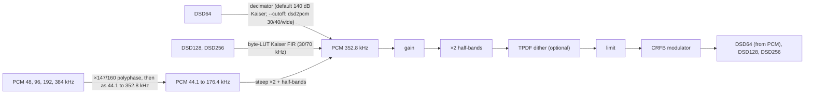

[dsd-upsample-rs](../README.md) › [Documentation](README.md) › Design

# Design

How dsd-upsample turns DSD or PCM into DSD, and why a release's output is designed to be
byte-identical on every platform (checked on Linux x86_64, macOS arm64 and Windows x64).

## Processing chain

- **Containers and DSD64 decimation** come from the `dsd2pcm` crate (a crates.io
  dependency). Its DSD64 decimator is sample-identical to scarletbook-pcm 0.7.0; here we take
  its 352.8 kHz output before the 24-bit rounding (2^26 grid, exact). The default first stage
  for DSD output is this crate's 140 dB Kaiser decimator; the dsd2pcm filters stay
  selectable with `--cutoff` ([why](measurements.md#dsd64-decimator-choice)).
- **Level convention**: 100 % modulation = 1.0; 0 dB SACD = 0.5. WAV full scale maps to
  0 dB SACD. Default gain −6 dB, so WAV full scale sits at −6 dB SACD (25 % modulation)
  and DSD input comes out 6 dB lower ([why](#decisions)).
- **48 kHz-family PCM** (48, 96, 192, 384 kHz) is first resampled by 147/160 to the
  44.1 kHz-family rate below it (44.1, 88.2, 176.4, 352.8 kHz), then takes that rate's
  chain. The resampler is a synchronous polyphase FIR: one linear-phase Kaiser prototype
  of 58,241 taps (397 per phase), flat to 20/44.1 of the new rate (20 kHz at 44.1 kHz)
  within ±5e-12 dB, stopband −244.6 dB at the new rate's Nyquist frequency and −256 dB
  from the input's, f64 arithmetic in a fixed order. Its delay (182 samples at the new rate) is compensated like
  every other stage's. [Resampler design](resampler-design.md).
- **Interpolators**: ×2 Kaiser half-bands (140 dB), flat to 80 kHz from 705.6 kHz up;
  WAV inputs first pass a steep ×2 stage (20 kHz/22.05 kHz scaled to the input rate).
  Delay is compensated exactly: every stage has an integer delay at the output rate, and
  the packer drops that many leading bits; the flush feeds idle input until the output has
  exactly `input samples × output rate / input rate` samples.
- **Modulator**: CRFB, orders 5-8 (5-7 at DSD128), one-bit, unity signal transfer function. The
  noise-transfer functions have their zeros over 0 to 20 kHz and maximally flat poles with
  H_inf 1.30 to 1.38 (`tools/modulator/design.py`). See
  [modulator design](modulator-design.md). Overload: input hard limit (default 0.51, that
  is 0.17 dB above 0 dB SACD), states clipped at 1.5, reset after 64 consecutive clipped
  samples; all counted.
- **Dither**: optional TPDF, ±1 LSB at 24 bits, SplitMix64 seeded per channel.
- **Threads**: two per channel, front end (decimator, interpolators, dither) and modulator,
  joined by bounded queues; the stages after the decimator run in blocks of 1024 samples so
  their buffers stay in cache. Output is independent of scheduling and identical to
  `--single-thread`.

## Determinism

All filter and modulator coefficients are committed tables (`tables.rs` from
`tools/gen_tables.py` and `resample_table.rs` from `tools/gen_resampler.py`, stored as f64 bit
patterns). Two structures are derived from them at start-up without any library maths: the
byte lookup tables of the DSD decimator, each entry a sum of eight committed taps with signs
in a fixed order, and the resampler's 147 polyphase branches, copied from the stored half of
its taps. The gain factor comes from dsd2pcm's fixed-order `db_to_linear`, test
sines from an exact-phase Taylor series. Arithmetic is scalar f64 with a fixed summation
order; Rust never contracts to FMA and no target-specific features are enabled. Golden
SHA-256 hashes of fixed synthetic conversions are checked in debug and release, and CI
checks them on Linux x86_64, macOS (arm64) and Windows x64, and on
`x86_64-unknown-linux-musl` (`tools/musl-check.sh`).

Each channel is converted on its own: without dither, a 1-channel stream fed one channel
gives the bytes of that channel in a multichannel stream, for DSD and PCM input
(`tests/channels.rs`). Dither is the exception: channel `c`'s generator is seeded with `c`,
so with dither only channel 0 matches a 1-channel conversion.

For programs that embed the library: `dsd_upsample::engine_id()` (`dsd-upsample/X.Y.Z`;
in C, `dsdup_version()` gives `X.Y.Z`) names the engine for cache keys, and
`cargo run --release -p dsd-upsample --example golden` prints SHA-256 hashes of
conversions at the default settings, of built-in test tones (stereo and 5.1, DSD and PCM
input) or of given files, to pin in the program's own tests.

This holds within a release. Between releases the output may change: when a measured
improvement is found, the defaults move to it. Every release lists its byte changes in the
changelog with their measured effect, and its quality must be no worse than the previous
release's on any metric beyond the suite's repeatability ([release test plan](release-test-plan.md)).
No setting promises identical bytes in later releases.

## Decisions

- **Default order 6 in the audio band (zeros over 0 to 20 kHz, H_inf 1.36) and input limit
  0.51, at every rate.** Why: the earlier tables (zeros spread to 50 or 80 kHz, H_inf 1.5)
  measured 66 to 69 dB less SINAD than SoX-DSD at DSD128 and DSD256 and still clipped
  their states on legal input at DSD64 (12 times in 60 s on a full-scale 88.2 kHz square,
  an error of −57 dB in the worst 10 ms) and on hot input at DSD64 and DSD128. Putting every zero in the audio
  band gives 157.1 dB (DSD128) and 195.8 dB (DSD256) at −3 dB SACD instead of 123.5 and
  126.2 dB; lowering H_inf to 1.36 is what keeps the loop stable, and it is the highest
  value at which no state clipped on any of 29 legal and 10 hot signals in 60 s runs at any
  rate. The cost: 15.5 dB (DSD128) and 16.7 dB (DSD256) more noise from 22 to 96 kHz than
  the earlier tables, and 7 dB of SINAD at DSD64.
  Orders 7 and 8 stay selectable, except order 8 at DSD128 (next decision); they are clean
  on legal input and can overload on hot ultrasonic input. The limit moved from 0.5 to 0.51 because at 0.5 a tone at
  exactly 0 dB SACD is itself limited (its interpolated peaks exceed 0.5); at 0.51 a 1 kHz tone at exactly 0 dB SACD has 53, 106
  and 212 samples limited in 60 s at DSD64, DSD128 and DSD256 (3 × 10⁻⁷ of them, from
  interpolator ripple), a 10 kHz tone 9, 17 and 35, a 20 kHz tone none
  ([DSD measurements](measurements-dsd.md#hot-input)). Candidates, measurements and rejected approaches:
  [modulator design](modulator-design.md).

- **Every accepted combination of band, order and output rate is clean on legal input;
  one noise-shaping band, and no option for the earlier tables.** The rule: the
  command-line tool, the library and the C interface accept a combination only if, at its
  default input limit, it clips no modulator state and never resets on the legal 60 s set
  (the 29 PCM signals of the stability study, 23 of the same kinds through the 48 kHz-family
  resampler, three sines held at 0 dB SACD and, for DSD128 and DSD256, DSD tones). The
  figures below were measured at a gain of −3 dB, the default at the time; the rule now
  holds at the default gain and at `--gain -3`, and at the default gain nothing may be
  limited on legal input (the headroom decision below).
  A mode that clips legal input is not shipped with
  a warning; it is refused. `accepted_orders` is the list, `tests/stability.rs` runs the
  set for 1.5 s per signal on every entry, and the release test plan runs the 60 s set
  when a table, the limit or the list changes. Measured, clipped states / resets over the
  set: the audio-band tables at limit 0.51, 0 / 0 for orders 5 to 8 at DSD64 and DSD256 and
  for orders 5 to 7 at DSD128; order 8 at DSD128, 58,116 / 823, all on one signal (a
  full-scale square at a quarter of the sample rate from 384 kHz PCM), so DSD128 accepts
  orders 5 to 7 and eleven combinations are accepted in all. No new table was made for
  order 8 at DSD128: it already needed a lower H_inf (1.30) than the others and measured
  3 dB more SINAD than order 7 for 26 dB more noise from 22 to 96 kHz. The earlier tables (zeros spread to 22, 50 or
  80 kHz, H_inf 1.5), which earlier builds offered as a second band with order 6 by
  default: at order 6 and limit 0.51, 1 / 0 (DSD64), 2 / 0 (DSD128) and 150 / 0 (DSD256),
  among them sines held at 0 dB SACD (on the set without the resampled signals); at limit 0.5073 still 3, 2 and 140, and at 0.5 a tone
  at 0 dB SACD is itself limited, so no limit fixes order 6; orders 7 and 8,
  1,385 to 172,691 clipped states. Their order 5 does pass (0 / 0 at every rate at limits
  0.5073, 0.51 and 0.53), so two options were weighed: keep the second band with order 5
  only, or leave it out. It is left out. Why: at DSD128 and DSD256 order 5 of the earlier
  tables measures −72.0 and −113.7 dBFS of noise from 22 to 96 kHz against −56.4 and
  −97.0 dBFS for the default, but with a SINAD of 115.0 and 129.1 dB against 159.9 and
  198.6 dB (1 kHz at 0 dB SACD, 64-bit float input at 88.2 kHz); at DSD64 it has no purpose (−40.9 dBFS
  against −42.5 dBFS for order 5 of the audio band) and overloads on hot input; its
  margin is smaller (at a limit of 0.55 the legal set clips 2,504 states at DSD128 and 110
  at DSD256, the default none); it would be a band whose only order is not the default
  order; and the modulator study has a candidate designed under the current stability
  rule that reaches −112.8 dBFS at DSD256 with a SINAD of 178.3 dB (modulator alone), from
  which a low-ultrasonic-noise mode could start. Adding a band later breaks nothing
  (`Band` is non-exhaustive; the C value 1 is reserved); removing one after a release
  would. The cost: no setting of this release gives less noise from 22 to 96 kHz than
  −62.2 dBFS at DSD128 (order 5) and −97.9 dBFS at DSD256 (order 7).
  [Modulator design](modulator-design.md#the-earlier-tables).

- **Default gain −6 dB for DSD output, from every input: legal input is not limited at the
  defaults.** Why: the limit cannot go
  up (0.51 is where the modulators stay stable), so the gain is the headroom, and −6 dB
  puts the limit at +6.17 dBTP for PCM and at 101.8 % modulation for DSD. The legal set
  has three parts, each measured 60 s per signal or over whole files
  ([modulator design, headroom](modulator-design.md#headroom), with sources):
  (1) clean DSD tones held at the Super Audio CD peak level of +3.1 dB SACD (1, 10 and
  19 kHz, from DSD64, DSD128 and DSD256) reach the modulator at +3.11 to +3.26 dB SACD and
  need a gain of at most −3.09 dB (margin at −6 dB: 2.91 dB);
  (2) PCM within full scale with a true peak up to +6 dBTP needs at most −5.83 dB (margin
  0.17 dB); a public scan of about 107,000 tracks has the 99th percentile of every genre at
  or below +4.22 dBTP (margin 1.95 dB), its highest rock track at +5.88 dBTP (margin
  0.29 dB) and one track at +7.72 dBTP, which is not covered;
  (3) the 332 readable files of the test music set: 139 PCM files peak at +2.15 dBTP or
  less (margin 4.02 dB), 133 DSD64 files at +3.95 dB SACD (2.22 dB), 38 DSD256 files at
  +2.16 dB SACD (4.01 dB) and 18 of 22 DSD128 files at +4.76 dB SACD (1.41 dB).
  The PCM ceiling binds. At the defaults every accepted combination of order and output
  rate limited nothing, clipped no state and never reset on the legal signals of the 60 s
  set (47 PCM signals, and 15 DSD tones at DSD128 and DSD256), and
  `tests/stability.rs` asserts it with every change, including the 0.17 dB margin.
  Outside the legal set, and stated as such: PCM whose true peak is above +6 dBTP (random
  ±full-scale samples at +7.21 to +8.00 dBTP and white noise peaking at full scale at
  +6.24 dBTP are limited, 448,229 to 1,792,737 samples over the five signals, with no
  clipped state and no reset), and four DSD128 tracks of one release in the music set,
  which carry a large DC offset (input mean −0.70 of full scale) and reach 109 to 110 %
  of full modulation after the input filter: at −6 dB they have 3,023 to 4,885 limited
  samples per channel, about one in a million, which the report shows and the warning
  (from 1 % of a channel's samples) does not; at −5 dB, 70 to 79 % of their samples.
  The cost, same source at −6 and at −3 dB (the earlier default): 3.0 to 3.6 dB of SINAD
  with a PCM source (114.7 instead of 118.2 dB at DSD64, 153.7 instead of 157.1 dB at
  DSD128, 192.2 instead of 195.8 dB at DSD256, 1 kHz at 0 dBFS, 64-bit float at 88.2 kHz,
  default order), 0.0 to
  0.2 dB with a DSD64 source, whose own noise sets the result, and an output 6 dB below
  the source. Options weighed: −3 dB (the earlier default) limits a clean 19 kHz tone at
  +3.1 dB SACD, three of the 133 DSD64 files and five of the 22 DSD128 files; −4 dB still
  limits the DSD128 file at +4.76 dB SACD and lies below the scan's 99th percentile for
  electronica; −5 dB passes that file and limits above +5.17 dBTP, below the scan's
  highest rock track, and limits most of the samples of the four offset tracks; −7 dB
  would limit nothing on those four tracks (margin 0.34 dB) but fits the default to one
  defective release, costs another decibel everywhere and still does not cover the
  +7.72 dBTP track, while −6 dB passes everything a DSD stream can hold (100 %
  modulation × 0.501 is below 0.51); a separate default for DSD input (−5 dB would do
  for the legal DSD set) gains nothing measurable, makes the default depend on the
  input, which the settings do not know when they are made, and is the gain at which the
  offset tracks are limited most of the time. A higher `--gain` stays available as the
  louder setting; every limited sample is counted in the report and in `--json`.
  The test-tone generator changed with this: its earlier modulator overloaded on loud
  tones (13 % of the samples of a 1 kHz tone at +3 dB SACD at DSD64 had clipped states),
  so loud `gen` tones were not clean streams; it now uses the order-7 modulator up to
  0 dB SACD and a second-order one up to +3.1 dB SACD, refuses higher levels, and a test
  checks that it never overloads.

- **48 kHz-family PCM through a synchronous 147/160 polyphase resampler to the
  44.1 kHz-family rate below it, then the existing chain.** Why: the test music set holds
  32 such files (mono to 6 channels) that were refused, and the user guide sent people to
  SoX or FFmpeg first. A synchronous rational resampler is exact in time (no rate
  estimation, no drift) and deterministic, which an asynchronous one is not. Options
  weighed: resampling to twice the partner rate (147/80) and skipping the steep ×2 stage
  needs the same filter for the same band edges and is slower (7.2 ms per
  channel-second at 48 kHz against 5.0 ms for resampler plus steep stage), while the
  partner mapping runs 48 kHz-family input through exactly the chain the measurements of
  44.1 kHz-family input describe; a shorter Kaiser design (240 dB by the formula,
  55,681 taps) saves 4 % of the resampler's work but its stopband edge measures only
  −226.0 dB. The filter (58,241 taps, stopband −244.6 dB at the edge, ripple within
  ±5e-12 dB, flat to 20 kHz at 48 kHz) keeps its own error
  at least 49 dB below the DSD256 floor; measured, 1 kHz SINAD from 48, 96, 192 and
  384 kHz equals that from 44.1, 88.2, 176.4 and 352.8 kHz within ±0.4 dB at DSD64, DSD128
  and DSD256, and IMD within 1.1 dB, both within the measurement's own scatter. Cost: 3.6 ms per channel-second
  at 48 kHz and 29 ms at 384 kHz; with the default threads no measurable wall-clock
  difference (within 1 %), single-threaded 4 to 26 % longer.
  [Resampler design](resampler-design.md),
  [measurements](measurements.md#48-khz-family-input).

## Not supported yet

Later phases may add DSD512 and DSD1024 output, filter presets, a second noise-shaping band
with lower ultrasonic noise, and a trellis modulator.
Speed work (SIMD across channels) must keep the output of a release byte-identical to its
scalar code on every platform.

## See also

- [Measurements](measurements.md): what the chain achieves
- [Options](options.md): the settings that select each stage
- [C interface](c-api.md)
- [Provenance](../PROVENANCE.md): where each design method comes from

Part of the [DSD Toolbox](https://github.com/dsd-toolbox/dsd-toolbox).
