[dsd-upsample-rs](../README.md) › [Documentation](README.md) › DSD measurements

# DSD measurements

How the DSD that dsd-upsample writes measures through a reference software decoder
(Archimago's "perfect DAC" method), next to SoX-DSD and a
24-bit PCM file of the same signal, in the style of
[Archimago](https://archimago.blogspot.com/)'s DSD articles. The defaults (order 6, input limit 0.51) come from the
[modulator design](modulator-design.md) study; the other orders are measured here too.

## Summary

Measured 2026-11-24 (tools, versions and hashes [below](#summary)) with a reference
decoder (see [method](#method)). Levels
are dBFS with 100 % modulation = 0 dBFS, so 0 dB SACD = −6.02 dBFS. "SoX" is SoX-DSD, run as
a black box. One row per encoder and DSD rate; the full set of SoX modulators is in
[all results](#all-results).

<!-- table:summary -->
| Encoder | SINAD, 0 dB SACD (dB) | THD+N at −2.9 dBFS (dB) | DR, A-weighted (dB) | Idle noise, digital silence, 20 Hz–20 kHz (dBFS) | Multitone DFR (dB) | CCIF IMD (dB) | SMPTE IMD (dB) | Ultrasonic 22–96 kHz (dBFS) | Highest ultrasonic density to 192 kHz (kHz, dBFS/Hz) |
|---|--:|--:|--:|--:|--:|--:|--:|--:|--:|
| PCM 24/88.2 | 138.9 | -142.0 | 141.1 | -144.9 | 155.3 | -157.6 | -144.7 | – | – |
| dsd-upsample order 5, DSD64 | 112.8 | -17.7 | 123.6 | -541.6 | 120.2 | -110.4 | -111.9 | -42.5 | 192, -78 |
| dsd-upsample order 6 (default), DSD64 | 121.1 | -17.7 | 123.0 | -126.0 | 126.3 | -113.3 | -122.0 | -28.9 | 66, -75 |
| dsd-upsample order 7, DSD64 | 128.7 | -17.7 | 139.8 | -143.3 | 135.2 | -121.2 | -133.5 | -39.5 | 192, -78 |
| dsd-upsample order 8, DSD64 | 134.1 | -17.7 | 136.0 | -139.3 | 139.9 | -123.3 | -131.5 | -24.4 | 54, -65 |
| SoX sdm-8, DSD64 | 140.7 | – | 145.3 | -148.1 | 151.0 | -150.0 | -139.3 | -27.7 | 67, -74 |
| SoX clans-8, DSD64 | 119.3 | – | 123.7 | -128.8 | 131.2 | -136.9 | -117.1 | -40.9 | 192, -75 |
| SoX clans-8 trellis, DSD64 | 117.6 | – | 127.4 | -134.1 | 127.6 | – | – | -41.8 | 192, -71 |
| dsd-upsample order 5, DSD128 | 145.6 | -17.7 | 143.3 | -551.8 | 151.5 | -139.6 | -142.2 | -62.1 | 153, -81 |
| dsd-upsample order 6 (default), DSD128 | 159.8 | -17.7 | 159.0 | -174.5 | 163.1 | -150.3 | -157.9 | -56.4 | 132, -78 |
| dsd-upsample order 7, DSD128 | 173.4 | -17.7 | 170.6 | -188.4 | 178.2 | -161.6 | -176.0 | -50.9 | 120, -73 |
| SoX sdm-8, DSD128 | 190.9 | – | 193.9 | -203.9 | 158.8 | -202.0 | -186.6 | -56.5 | 136, -72 |
| SoX clans-8, DSD128 | 180.0 | – | 184.0 | -191.8 | 158.8 | -194.5 | -176.8 | -62.2 | 191, -85 |
| SoX clans-7 trellis, DSD128 | 157.9 | – | 161.7 | -179.8 | 157.6 | – | – | -56.9 | 192, -85 |
| dsd-upsample order 5, DSD256 | 177.6 | -17.7 | 172.2 | -565.0 | 182.9 | -169.3 | -172.6 | -95.9 | 192, -109 |
| dsd-upsample order 6 (default), DSD256 | 191.0 | -17.7 | 192.4 | -213.4 | 196.8 | -186.3 | -193.0 | -97.0 | 192, -103 |
| dsd-upsample order 7, DSD256 | 191.9 | -17.7 | 193.9 | -237.6 | 198.0 | -204.0 | -198.3 | -97.9 | 192, -96 |
| dsd-upsample order 8, DSD256 | 191.9 | -17.7 | 193.9 | -249.7 | 198.0 | -210.9 | -198.3 | -95.1 | 192, -84 |
| SoX sdm-8, DSD256 | 197.7 | – | 200.0 | -252.2 | 158.8 | -216.2 | -202.3 | -107.7 | 192, -101 |
| SoX clans-8, DSD256 | 40.2 | – | 200.0 | -239.7 | 158.8 | -216.2 | -21.7 | -101.3 | 192, -111 |
| SoX clans-6 trellis, DSD256 | 180.7 | – | 188.0 | -201.8 | 158.7 | – | – | -89.3 | 191, -107 |
<!-- /table -->

- **SINAD** is for a 1 kHz tone at 0 dB SACD. **THD+N at −2.9 dBFS** is the +3.1 dB SACD
  peak level; dsd-upsample hard-limits its input there (default limit 0.51, +0.17 dB SACD),
  SoX cannot reach it from PCM ("–", see [SoX-DSD](#sox-dsd-as-a-reference)).
- dsd-upsample rows are at the default input limit (0.51) for every order; "(default)"
  marks the default order. Order 8 is not accepted at DSD128
  ([modulator design](modulator-design.md#orders-7-and-8)), so it has no row there.
- The sources are 32-bit integer WAV, whose own noise limits SINAD at 0 dB SACD to
  191.8 dB (197.8 dB for SoX, which is fed 6 dB hotter): at DSD256, orders 6 to 8 of
  dsd-upsample (191.0 to 191.9 dB, within 0.8 dB of that limit; order 7 and 8's 191.9 dB is
  0.1 dB above it, the measurement's scatter) and SoX `sdm-8` (197.7 dB) read the source's
  noise, not the modulator's.
- **DR** is AES17-style, not AES17: from a 1 kHz tone (moved onto an FFT bin) at −60 dB
  SACD (−66.02 dBFS), relative to 0 dB SACD, A-weighted here. AES17 uses 997 Hz at −60 dB
  relative to the maximum level and the CCIR-RMS weighting.
- **Idle noise** is for digital silence. Order 5 of dsd-upsample settles into a fixed bit
  pattern on silence with nothing in the audio band, hence values below −250 dBFS.
- **Multitone DFR** is the distortion-free range of the 32-tone signal at a −6.02 dBFS
  peak, with 2^20-point FFTs (0.34 Hz bins). It is larger than figures made with shorter
  FFTs, because the noise per bin falls as the bins get narrower.
- **Ultrasonic** figures are for the −60 dB SACD tone, as in Archimago's articles.

Tools and versions behind every table and plot on this page:

<!-- table:provenance -->
| Tool | Version | Source | SHA-256 of the binary |
|---|---|---|---|
| dsd-upsample (CLI) | dsd-upsample 0.1.0 | the 0.1.0 conversion code (a 0.1.0 release-candidate build); defaults order 6, limit 0.51, gain -6 dB | `f9c8d29a3a2184774121f6e4bf2c0071553b3f1b499a8091699f10bbb22cca24` |
| SoX-DSD, run as a black box | SoX v14.4.2 | mansr/sox 0be259eaa9ce3f3fa587a3ef0cf2c0b9c73167a2, static build, tools/measure/sox-dsd.Containerfile; OMP_NUM_THREADS=1 | `8e71f0f19fdad9c19275ec3204b7280f4dd4781ec02c9de83182f20d5803bd58` |
| dsd-upsample (CLI), real-music and intersample-over rows | dsd-upsample 0.1.0 | the 0.1.0 conversion code (a 0.1.0 release-candidate build); measured 2026-11-24 on AMD RYZEN AI MAX+ 395 w/ Radeon 8060S; Python 3.9.25, NumPy 1.21.6, SciPy 1.7.3 | `f9c8d29a3a2184774121f6e4bf2c0071553b3f1b499a8091699f10bbb22cca24` |
| Analysis (tools/measure) | Python 3.9.25, NumPy 1.21.6, SciPy 1.7.3, Matplotlib 3.5.3 | this tree | – |

Measured 2026-11-24 on AMD Ryzen AI 9 HX 370 w/ Radeon 890M.
<!-- /table -->

Reproduce (all tables on this page are then written by
`python tools/measure_dsdup.py report --work target/dsdmeasure --doc docs/measurements-dsd.md`):

```sh
python tools/measure_dsdup.py run --work target/dsdmeasure --only main
```


## Defaults

The defaults are **order 6 at every rate, input limit 0.51** (0.17 dB above 0 dB SACD).
They come from the [modulator design](modulator-design.md) study, whose acceptance test is
a stability study on legal and hot signals. This section measures them near full scale
and under hot input with the reference decoder. From the tables below:

- No tone from −6 to +1 dB SACD, at 1, 10 or 20 kHz, made any order clip a modulator state
  at any rate.
- In 60 s holds at 0 dB SACD the defaults had no clip event.
- On hot tones at a gain of −3 dB (`--gain -3`, 3 dB above the default −6 dB; +3.1, +4.8
  and +7.0 dB SACD before the gain) the default order and limit had no clip event and no
  reset at any rate, and the output differed from an ideal hard limiter by at most
  −114.4 dB in the worst 10 ms (DSD64, 20 kHz).
- The defaults' SINAD at −3 dB SACD is 118.3 dB (DSD64), 157.1 dB (DSD128) and 188.0 dB
  (DSD256, 0.8 dB below the 188.8 dB limit of the 32-bit source).
- Eight real recordings below, converted whole at the defaults and at every other
  accepted order, reached the limiter nowhere and caused no clip event or reset.

### Clean ceiling per order and rate

```sh
python tools/measure_dsdup.py run --work target/dsdmeasure --only ceiling
```

A 1, 10 or 20 kHz tone from −6 to +1 dB SACD in 0.5 dB steps (3 s each), at the
"output level = input level" setting (`--gain 6.0206`), at the default input limit 0.51.
The first clip event is the lowest level at which the modulator had to clip its states.

<!-- table:ceiling -->
| Output | Order | Limit | Tone (kHz) | SINAD at −6 / −3 / 0 dB SACD (dB) | First clip event (dB SACD) | Clean ceiling, no clip or limiter event (dB SACD) | Clean ceiling, SINAD ≥ value at −6 dB SACD − 3 dB (dB SACD) |
|---|--:|--:|--:|--:|--:|--:|--:|
| DSD64 | 5 | 0.51 | 1 | 106.6 / 110.2 / 112.8 | none up to +1.0 | -1.0 | +0.0 |
| DSD64 | 5 | 0.51 | 10 | 107.5 / 110.3 / 113.6 | none up to +1.0 | -1.0 | +1.0 |
| DSD64 | 5 | 0.51 | 20 | 106.4 / 110.5 / 113.8 | none up to +1.0 | +0.0 | +0.0 |
| DSD64 | 6 | 0.51 | 1 | 114.5 / 118.3 / 121.1 | none up to +1.0 | -1.0 | +0.0 |
| DSD64 | 6 | 0.51 | 10 | 114.6 / 118.7 / 121.1 | none up to +1.0 | -1.0 | +0.5 |
| DSD64 | 6 | 0.51 | 20 | 115.3 / 118.5 / 120.9 | none up to +1.0 | +0.0 | +0.0 |
| DSD64 | 7 | 0.51 | 1 | 122.3 / 125.8 / 128.7 | none up to +1.0 | -1.0 | +0.0 |
| DSD64 | 7 | 0.51 | 10 | 123.1 / 126.2 / 129.5 | none up to +1.0 | -1.0 | +0.0 |
| DSD64 | 7 | 0.51 | 20 | 122.4 / 126.4 / 129.6 | none up to +1.0 | +0.0 | +0.0 |
| DSD64 | 8 | 0.51 | 1 | 127.8 / 131.3 / 134.1 | none up to +1.0 | -1.0 | +0.0 |
| DSD64 | 8 | 0.51 | 10 | 127.6 / 131.4 / 134.4 | none up to +1.0 | -1.0 | +0.0 |
| DSD64 | 8 | 0.51 | 20 | 128.0 / 131.3 / 134.4 | none up to +1.0 | +0.0 | +0.0 |
| DSD128 | 5 | 0.51 | 1 | 139.4 / 142.8 / 145.6 | none up to +1.0 | -1.0 | +0.0 |
| DSD128 | 5 | 0.51 | 10 | 140.3 / 143.3 / 146.5 | none up to +1.0 | -1.0 | +0.0 |
| DSD128 | 5 | 0.51 | 20 | 140.7 / 143.6 / 146.7 | none up to +1.0 | +0.0 | +0.0 |
| DSD128 | 6 | 0.51 | 1 | 153.6 / 157.1 / 159.8 | none up to +1.0 | -1.0 | +0.0 |
| DSD128 | 6 | 0.51 | 10 | 153.9 / 157.6 / 160.5 | none up to +1.0 | -1.0 | +0.0 |
| DSD128 | 6 | 0.51 | 20 | 154.5 / 157.7 / 160.6 | none up to +1.0 | +0.0 | +0.0 |
| DSD128 | 7 | 0.51 | 1 | 166.9 / 170.3 / 173.4 | none up to +1.0 | -1.0 | +0.0 |
| DSD128 | 7 | 0.51 | 10 | 167.7 / 171.1 / 174.1 | none up to +1.0 | -1.0 | +0.0 |
| DSD128 | 7 | 0.51 | 20 | 168.1 / 171.4 / 174.1 | none up to +1.0 | +0.0 | +0.0 |
| DSD256 | 5 | 0.51 | 1 | 171.8 / 175.1 / 177.6 | none up to +1.0 | -1.0 | +0.0 |
| DSD256 | 5 | 0.51 | 10 | 173.3 / 176.5 / 179.5 | none up to +1.0 | -1.0 | +0.0 |
| DSD256 | 5 | 0.51 | 20 | 172.9 / 176.5 / 179.3 | none up to +1.0 | +0.0 | +0.0 |
| DSD256 | 6 | 0.51 | 1 | 184.9 / 188.0 / 191.0 | none up to +1.0 | -1.0 | +0.0 |
| DSD256 | 6 | 0.51 | 10 | 185.0 / 188.1 / 191.3 | none up to +1.0 | -1.0 | +0.0 |
| DSD256 | 6 | 0.51 | 20 | 185.0 / 188.2 / 191.0 | none up to +1.0 | +0.0 | +0.0 |
| DSD256 | 7 | 0.51 | 1 | 185.9 / 188.8 / 191.9 | none up to +1.0 | -1.0 | +0.0 |
| DSD256 | 7 | 0.51 | 10 | 185.8 / 188.7 / 192.0 | none up to +1.0 | -1.0 | +0.0 |
| DSD256 | 7 | 0.51 | 20 | 185.7 / 188.8 / 191.7 | none up to +1.0 | +0.0 | +0.0 |
| DSD256 | 8 | 0.51 | 1 | 185.9 / 188.8 / 191.9 | none up to +1.0 | -1.0 | +0.0 |
| DSD256 | 8 | 0.51 | 10 | 185.8 / 188.7 / 192.0 | none up to +1.0 | -1.0 | +0.0 |
| DSD256 | 8 | 0.51 | 20 | 185.7 / 188.8 / 191.7 | none up to +1.0 | +0.0 | +0.0 |
<!-- /table -->

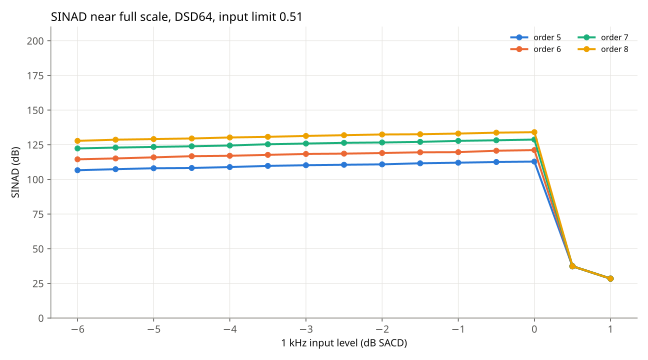

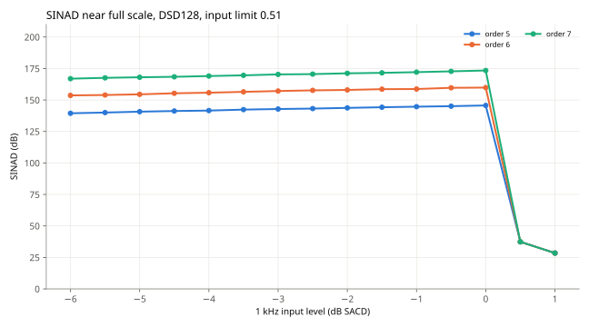

SINAD rises with level up to the limit (+0.17 dB SACD); above it the input is hard-limited.
At DSD256 orders 6 to 8 come within 0.8 dB of the limit of the 32-bit source (191.8 dB at
0 dB SACD).

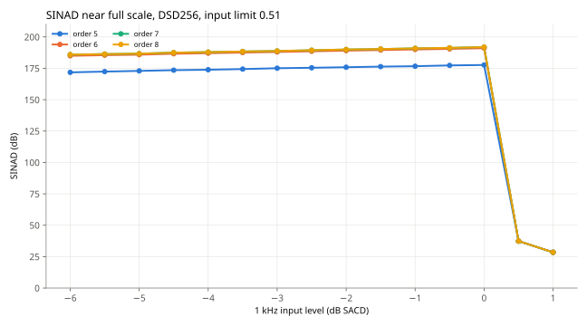

### Hot input

```sh
python tools/measure_dsdup.py run --work target/dsdmeasure --only final
```

60 s holds at 0 dB SACD, and hot PCM tones at a gain of −3 dB (`--gain -3`, 3 dB above the default; input +3.1,
+4.8 and +7.0 dB SACD, that is +0.1, +1.8 and +4.0 dB SACD at the modulator). "Excess"
is the error of the output against an ideal hard limiter (the same tone, clipped at the
limit in 64-bit floating point, through the same reference decoder, 20 Hz–20 kHz); at the
modulator's own noise floor it reads −114.4 to −123.1 dB at DSD64, −152.8 to −160.8 dB at
DSD128 and −156.6 to −198.7 dB at DSD256 in the table below.

<!-- table:trials -->
| Output | Order, limit | Clip events, 60 s at 0 dB SACD, 1 / 10 / 20 kHz | Limited samples, 1 / 10 / 20 kHz |
|---|--:|--:|--:|
| DSD64 | 6, 0.51 (defaults) | 0 / 0 / 0 | 53 / 9 / 0 |
| DSD128 | 6, 0.51 (defaults) | 0 / 0 / 0 | 106 / 17 / 0 |
| DSD256 | 6, 0.51 (defaults) | 0 / 0 / 0 | 212 / 35 / 0 |
<!-- /table -->

<!-- table:hot -->
| Output | Order, limit | Input before gain (dB SACD) | Tone (kHz) | Limited (s of 60) | Clip events | Resets | THD+N first / last 10 s (dB) | Excess over ideal limiter, whole / worst 10 ms (dB re the ideal signal) | Max modulation, 28-bit window (%) | Recovery (ms) |
|---|--:|--:|--:|--:|--:|--:|--:|--:|--:|--:|
| DSD64 | 6, 0.51, gain -3 dB | +3.1 | 1 | 0.0 | 0 | 0 | -121.1 / -121.3 | -121.3 / -120.3 | 57.1 | 0 |
| DSD64 | 6, 0.51, gain -3 dB | +3.1 | 10 | 0.0 | 0 | 0 | -121.4 / -121.2 | -121.4 / -120.1 | 57.1 | 200 |
| DSD64 | 6, 0.51, gain -3 dB | +3.1 | 20 | 0.0 | 0 | 0 | -121.1 / -121.1 | -115.3 / -114.4 | 57.1 | 150 |
| DSD64 | 6, 0.51, gain -3 dB | +4.8 | 1 | 22.8 | 0 | 0 | -22.4 / -22.4 | -121.9 / -121.0 | 57.1 | 100 |
| DSD64 | 6, 0.51, gain -3 dB | +4.8 | 10 | 22.8 | 0 | 0 | -100.0 / -100.0 | -122.5 / -121.4 | 57.1 | 100 |
| DSD64 | 6, 0.51, gain -3 dB | +4.8 | 20 | 22.8 | 0 | 0 | -95.6 / -95.6 | -116.7 / -115.8 | 57.1 | 150 |
| DSD64 | 6, 0.51, gain -3 dB | +7.0 | 1 | 33.6 | 0 | 0 | -15.7 / -15.7 | -121.8 / -120.8 | 57.1 | 50 |
| DSD64 | 6, 0.51, gain -3 dB | +7.0 | 10 | 33.6 | 0 | 0 | -95.4 / -95.4 | -123.1 / -121.9 | 57.1 | 0 |
| DSD64 | 6, 0.51, gain -3 dB | +7.0 | 20 | 33.6 | 0 | 0 | -84.4 / -84.4 | -117.2 / -116.3 | 57.1 | 200 |
| DSD128 | 6, 0.51, gain -3 dB | +3.1 | 1 | 0.0 | 0 | 0 | -159.8 / -160.1 | -160.2 / -159.2 | 57.1 | 0 |
| DSD128 | 6, 0.51, gain -3 dB | +3.1 | 10 | 0.0 | 0 | 0 | -160.7 / -160.6 | -160.8 / -159.9 | 57.1 | 0 |
| DSD128 | 6, 0.51, gain -3 dB | +3.1 | 20 | 0.0 | 0 | 0 | -160.0 / -160.3 | -154.4 / -153.3 | 57.1 | 0 |
| DSD128 | 6, 0.51, gain -3 dB | +4.8 | 1 | 22.8 | 0 | 0 | -22.4 / -22.4 | -160.3 / -159.4 | 57.1 | 0 |
| DSD128 | 6, 0.51, gain -3 dB | +4.8 | 10 | 22.8 | 0 | 0 | -113.8 / -113.8 | -160.4 / -159.4 | 64.3 | 0 |
| DSD128 | 6, 0.51, gain -3 dB | +4.8 | 20 | 22.8 | 0 | 0 | -112.2 / -112.2 | -154.1 / -153.5 | 57.1 | 0 |
| DSD128 | 6, 0.51, gain -3 dB | +7.0 | 1 | 33.6 | 0 | 0 | -15.7 / -15.7 | -159.7 / -158.9 | 64.3 | 0 |
| DSD128 | 6, 0.51, gain -3 dB | +7.0 | 10 | 33.6 | 0 | 0 | -106.9 / -106.9 | -160.7 / -160.0 | 64.3 | 0 |
| DSD128 | 6, 0.51, gain -3 dB | +7.0 | 20 | 33.6 | 0 | 0 | -108.7 / -108.7 | -153.5 / -152.8 | 64.3 | 0 |
| DSD256 | 6, 0.51, gain -3 dB | +3.1 | 1 | 0.0 | 0 | 0 | -198.6 / -198.6 | -198.7 / -197.8 | 57.1 | 0 |
| DSD256 | 6, 0.51, gain -3 dB | +3.1 | 10 | 0.0 | 0 | 0 | -199.8 / -195.9 | -196.0 / -195.1 | 57.1 | 0 |
| DSD256 | 6, 0.51, gain -3 dB | +3.1 | 20 | 0.0 | 0 | 0 | -199.6 / -191.0 | -185.0 / -184.7 | 57.1 | 0 |
| DSD256 | 6, 0.51, gain -3 dB | +4.8 | 1 | 22.8 | 0 | 0 | -22.4 / -22.4 | -192.8 / -192.5 | 64.3 | 0 |
| DSD256 | 6, 0.51, gain -3 dB | +4.8 | 10 | 22.8 | 0 | 0 | -125.6 / -125.6 | -166.0 / -165.9 | 64.3 | 0 |
| DSD256 | 6, 0.51, gain -3 dB | +4.8 | 20 | 22.8 | 0 | 0 | -116.1 / -116.1 | -160.1 / -160.1 | 64.3 | 0 |
| DSD256 | 6, 0.51, gain -3 dB | +7.0 | 1 | 33.6 | 0 | 0 | -15.7 / -15.7 | -192.3 / -192.0 | 64.3 | 0 |
| DSD256 | 6, 0.51, gain -3 dB | +7.0 | 10 | 33.6 | 0 | 0 | -118.9 / -118.9 | -165.6 / -165.5 | 64.3 | 0 |
| DSD256 | 6, 0.51, gain -3 dB | +7.0 | 20 | 33.6 | 0 | 0 | -110.3 / -110.3 | -156.6 / -156.6 | 64.3 | 0 |
<!-- /table -->

### Intersample overs

```sh
python tools/measure_dsdup_music.py --work target/dsdmeasure --music target/music --only isp
```

An 11.025 kHz (44.1 kHz source) or 22.05 kHz (88.2 kHz source) tone at 0 dBFS sampled at
45°: the samples reach full scale and the true peak is +3.01 dBFS, which reaches the
modulator at −3 dB SACD after the default −6 dB gain, 3.2 dB below the limit.

<!-- table:isp -->
| Source rate | Output | Order, limit | Limited | Clip events | Resets | SINAD (dB) |
|---|---|--:|--:|--:|--:|--:|
| 44.1 kHz | DSD64 | 6, 0.51 (defaults) | 0 | 0 | 0 | 118.4 |
| 44.1 kHz | DSD128 | 6, 0.51 (defaults) | 0 | 0 | 0 | 157.7 |
| 44.1 kHz | DSD256 | 6, 0.51 (defaults) | 0 | 0 | 0 | 196.8 |
| 88.2 kHz | DSD64 | 6, 0.51 (defaults) | 0 | 0 | 0 | 117.9 |
| 88.2 kHz | DSD128 | 6, 0.51 (defaults) | 0 | 0 | 0 | 157.7 |
| 88.2 kHz | DSD256 | 6, 0.51 (defaults) | 0 | 0 | 0 | 196.7 |
<!-- /table -->

At the defaults nothing is limited and no state clips.

### Real material

```sh
python tools/measure_dsdup_music.py --work target/dsdmeasure --music target/music --only peaks,final,convert
```

`target/music` holds your own DSF files and 44.1 kHz-family WAV files; no music is part of
the repository. Eight tracks were converted whole: four stereo DSD64 DSF files ripped from
SACDs (m1 to m4) and four PCM tracks decoded from FLAC to WAV (m5 and m6: 16-bit, 44.1 kHz;
m7: 24-bit, 44.1 kHz; m8: 24-bit, 88.2 kHz), chosen as the loudest of their kind in a
larger test set (integrated loudness of a 60 s excerpt −4.7 to −8.7 LUFS for the PCM
tracks). Tracks are named by number only. The peak is the largest sample of the reference
decode (wideband, which for DSD64 includes its ultrasonic noise) and the 4× oversampled
true peak below 25 kHz. Each conversion is compared with the same conversion at 6.02 dB
lower gain, scaled back up: limiting or clipping would show as error blocks. A recording's
own noise floor cannot be separated from its content, so it is not given; the comparison
does not depend on it, because both conversions carry the same source.

At the defaults (order 6, limit 0.51, gain −6 dB):

<!-- table:music -->
| Track | Peak, wideband / audio band (dB SACD) | Output | Order, limit | Limited time (s, % of track) | Clip events | Resets | Limiter events (50 ms blocks, error > −100 dBFS) | Longest (s) | Worst block error re signal (dB) | Whole-track error re signal (dB) |
|---|--:|---|--:|--:|--:|--:|--:|--:|--:|--:|
| m1 | +8.3 / +3.6 | DSD128 | 6, 0.51 (defaults) | 0.000 (0.000 %) | 0 | 0 | 0 | 0.00 | – | -137.8 |
| m1 | +8.3 / +3.6 | DSD256 | 6, 0.51 (defaults) | 0.000 (0.000 %) | 0 | 0 | 0 | 0.00 | – | -159.5 |
| m2 | +6.5 / +3.2 | DSD128 | 6, 0.51 (defaults) | 0.000 (0.000 %) | 0 | 0 | 0 | 0.00 | – | -133.5 |
| m2 | +6.5 / +3.2 | DSD256 | 6, 0.51 (defaults) | 0.000 (0.000 %) | 0 | 0 | 0 | 0.00 | – | -158.5 |
| m3 | +4.1 / +1.5 | DSD128 | 6, 0.51 (defaults) | 0.000 (0.000 %) | 0 | 0 | 0 | 0.00 | – | -141.1 |
| m3 | +4.1 / +1.5 | DSD256 | 6, 0.51 (defaults) | 0.000 (0.000 %) | 0 | 0 | 0 | 0.00 | – | -160.0 |
| m4 | +4.7 / +0.3 | DSD128 | 6, 0.51 (defaults) | 0.000 (0.000 %) | 0 | 0 | 0 | 0.00 | – | -129.4 |
| m4 | +4.7 / +0.3 | DSD256 | 6, 0.51 (defaults) | 0.000 (0.000 %) | 0 | 0 | 0 | 0.00 | – | -156.7 |
| m5 | -0.0 / +1.1 | DSD64 | 6, 0.51 (defaults) | 0.000 (0.000 %) | 0 | 0 | 0 | 0.00 | – | -103.0 |
| m5 | -0.0 / +1.1 | DSD128 | 6, 0.51 (defaults) | 0.000 (0.000 %) | 0 | 0 | 0 | 0.00 | – | -142.0 |
| m5 | -0.0 / +1.1 | DSD256 | 6, 0.51 (defaults) | 0.000 (0.000 %) | 0 | 0 | 0 | 0.00 | – | -160.0 |
| m6 | -0.2 / -0.2 | DSD64 | 6, 0.51 (defaults) | 0.000 (0.000 %) | 0 | 0 | 0 | 0.00 | – | -101.2 |
| m6 | -0.2 / -0.2 | DSD128 | 6, 0.51 (defaults) | 0.000 (0.000 %) | 0 | 0 | 0 | 0.00 | – | -140.2 |
| m6 | -0.2 / -0.2 | DSD256 | 6, 0.51 (defaults) | 0.000 (0.000 %) | 0 | 0 | 0 | 0.00 | – | -159.9 |
| m7 | -0.5 / +0.2 | DSD64 | 6, 0.51 (defaults) | 0.000 (0.000 %) | 0 | 0 | 0 | 0.00 | – | -100.8 |
| m7 | -0.5 / +0.2 | DSD128 | 6, 0.51 (defaults) | 0.000 (0.000 %) | 0 | 0 | 0 | 0.00 | – | -139.8 |
| m7 | -0.5 / +0.2 | DSD256 | 6, 0.51 (defaults) | 0.000 (0.000 %) | 0 | 0 | 0 | 0.00 | – | -159.9 |
| m8 | -0.1 / +0.0 | DSD64 | 6, 0.51 (defaults) | 0.000 (0.000 %) | 0 | 0 | 0 | 0.00 | – | -98.2 |
| m8 | -0.1 / +0.0 | DSD128 | 6, 0.51 (defaults) | 0.000 (0.000 %) | 0 | 0 | 0 | 0.00 | – | -137.3 |
| m8 | -0.1 / +0.0 | DSD256 | 6, 0.51 (defaults) | 0.000 (0.000 %) | 0 | 0 | 0 | 0.00 | – | -159.5 |
<!-- /table -->

At the other orders each rate accepts, same limit and gain:

<!-- table:music_orders -->
| Track | Peak, wideband / audio band (dB SACD) | Output | Order, limit | Limited time (s, % of track) | Clip events | Resets | Limiter events (50 ms blocks, error > −100 dBFS) | Longest (s) | Worst block error re signal (dB) | Whole-track error re signal (dB) |
|---|--:|---|--:|--:|--:|--:|--:|--:|--:|--:|
| m1 | +8.3 / +3.6 | DSD128 | 5, 0.51 | 0.000 (0.000 %) | 0 | 0 | 0 | 0.00 | – | -124.5 |
| m1 | +8.3 / +3.6 | DSD128 | 7, 0.51 | 0.000 (0.000 %) | 0 | 0 | 0 | 0.00 | – | -149.8 |
| m1 | +8.3 / +3.6 | DSD256 | 5, 0.51 | 0.000 (0.000 %) | 0 | 0 | 0 | 0.00 | – | -155.3 |
| m1 | +8.3 / +3.6 | DSD256 | 7, 0.51 | 0.000 (0.000 %) | 0 | 0 | 0 | 0.00 | – | -158.9 |
| m1 | +8.3 / +3.6 | DSD256 | 8, 0.51 | 0.000 (0.000 %) | 0 | 0 | 0 | 0.00 | – | -158.5 |
| m2 | +6.5 / +3.2 | DSD128 | 5, 0.51 | 0.000 (0.000 %) | 0 | 0 | 0 | 0.00 | – | -119.9 |
| m2 | +6.5 / +3.2 | DSD128 | 7, 0.51 | 0.000 (0.000 %) | 0 | 0 | 0 | 0.00 | – | -146.0 |
| m2 | +6.5 / +3.2 | DSD256 | 5, 0.51 | 0.000 (0.000 %) | 0 | 0 | 0 | 0.00 | – | -151.8 |
| m2 | +6.5 / +3.2 | DSD256 | 7, 0.51 | 0.000 (0.000 %) | 0 | 0 | 0 | 0.00 | – | -157.9 |
| m2 | +6.5 / +3.2 | DSD256 | 8, 0.51 | 0.000 (0.000 %) | 0 | 0 | 0 | 0.00 | – | -157.0 |
| m3 | +4.1 / +1.5 | DSD128 | 5, 0.51 | 0.000 (0.000 %) | 0 | 0 | 0 | 0.00 | – | -127.8 |
| m3 | +4.1 / +1.5 | DSD128 | 7, 0.51 | 0.000 (0.000 %) | 0 | 0 | 0 | 0.00 | – | -152.8 |
| m3 | +4.1 / +1.5 | DSD256 | 5, 0.51 | 0.000 (0.000 %) | 0 | 0 | 0 | 0.00 | – | -157.1 |
| m3 | +4.1 / +1.5 | DSD256 | 7, 0.51 | 0.000 (0.000 %) | 0 | 0 | 0 | 0.00 | – | -159.4 |
| m3 | +4.1 / +1.5 | DSD256 | 8, 0.51 | 0.000 (0.000 %) | 0 | 0 | 0 | 0.00 | – | -159.2 |
| m4 | +4.7 / +0.3 | DSD128 | 5, 0.51 | 0.000 (0.000 %) | 0 | 0 | 0 | 0.00 | – | -116.2 |
| m4 | +4.7 / +0.3 | DSD128 | 7, 0.51 | 0.000 (0.000 %) | 0 | 0 | 0 | 0.00 | – | -142.5 |
| m4 | +4.7 / +0.3 | DSD256 | 5, 0.51 | 0.000 (0.000 %) | 0 | 0 | 0 | 0.00 | – | -148.5 |
| m4 | +4.7 / +0.3 | DSD256 | 7, 0.51 | 0.000 (0.000 %) | 0 | 0 | 0 | 0.00 | – | -156.1 |
| m4 | +4.7 / +0.3 | DSD256 | 8, 0.51 | 0.000 (0.000 %) | 0 | 0 | 0 | 0.00 | – | -154.8 |
| m5 | -0.0 / +1.1 | DSD64 | 5, 0.51 | 0.000 (0.000 %) | 0 | 0 | 0 | 0.00 | – | -95.7 |
| m5 | -0.0 / +1.1 | DSD64 | 7, 0.51 | 0.000 (0.000 %) | 0 | 0 | 0 | 0.00 | – | -111.3 |
| m5 | -0.0 / +1.1 | DSD64 | 8, 0.51 | 0.000 (0.000 %) | 0 | 0 | 0 | 0.00 | – | -116.1 |
| m5 | -0.0 / +1.1 | DSD128 | 5, 0.51 | 0.000 (0.000 %) | 0 | 0 | 0 | 0.00 | – | -128.7 |
| m5 | -0.0 / +1.1 | DSD128 | 7, 0.51 | 0.000 (0.000 %) | 0 | 0 | 0 | 0.00 | – | -153.4 |
| m5 | -0.0 / +1.1 | DSD256 | 5, 0.51 | 0.000 (0.000 %) | 0 | 0 | 0 | 0.00 | – | -157.6 |
| m5 | -0.0 / +1.1 | DSD256 | 7, 0.51 | 0.000 (0.000 %) | 0 | 0 | 0 | 0.00 | – | -159.5 |
| m5 | -0.0 / +1.1 | DSD256 | 8, 0.51 | 0.000 (0.000 %) | 0 | 0 | 0 | 0.00 | – | -159.4 |
| m6 | -0.2 / -0.2 | DSD64 | 5, 0.51 | 0.000 (0.000 %) | 0 | 0 | 0 | 0.00 | – | -93.8 |
| m6 | -0.2 / -0.2 | DSD64 | 7, 0.51 | 0.000 (0.000 %) | 0 | 0 | 0 | 0.00 | – | -109.5 |
| m6 | -0.2 / -0.2 | DSD64 | 8, 0.51 | 0.000 (0.000 %) | 0 | 0 | 0 | 0.00 | – | -114.4 |
| m6 | -0.2 / -0.2 | DSD128 | 5, 0.51 | 0.000 (0.000 %) | 0 | 0 | 0 | 0.00 | – | -126.8 |
| m6 | -0.2 / -0.2 | DSD128 | 7, 0.51 | 0.000 (0.000 %) | 0 | 0 | 0 | 0.00 | – | -151.9 |
| m6 | -0.2 / -0.2 | DSD256 | 5, 0.51 | 0.000 (0.000 %) | 0 | 0 | 0 | 0.00 | – | -156.7 |
| m6 | -0.2 / -0.2 | DSD256 | 7, 0.51 | 0.000 (0.000 %) | 0 | 0 | 0 | 0.00 | – | -159.3 |
| m6 | -0.2 / -0.2 | DSD256 | 8, 0.51 | 0.000 (0.000 %) | 0 | 0 | 0 | 0.00 | – | -159.1 |
| m7 | -0.5 / +0.2 | DSD64 | 5, 0.51 | 0.000 (0.000 %) | 0 | 0 | 0 | 0.00 | – | -93.6 |
| m7 | -0.5 / +0.2 | DSD64 | 7, 0.51 | 0.000 (0.000 %) | 0 | 0 | 0 | 0.00 | – | -109.2 |
| m7 | -0.5 / +0.2 | DSD64 | 8, 0.51 | 0.000 (0.000 %) | 0 | 0 | 0 | 0.00 | – | -114.1 |
| m7 | -0.5 / +0.2 | DSD128 | 5, 0.51 | 0.000 (0.000 %) | 0 | 0 | 0 | 0.00 | – | -126.6 |
| m7 | -0.5 / +0.2 | DSD128 | 7, 0.51 | 0.000 (0.000 %) | 0 | 0 | 0 | 0.00 | – | -151.7 |
| m7 | -0.5 / +0.2 | DSD256 | 5, 0.51 | 0.000 (0.000 %) | 0 | 0 | 0 | 0.00 | – | -156.6 |
| m7 | -0.5 / +0.2 | DSD256 | 7, 0.51 | 0.000 (0.000 %) | 0 | 0 | 0 | 0.00 | – | -159.3 |
| m7 | -0.5 / +0.2 | DSD256 | 8, 0.51 | 0.000 (0.000 %) | 0 | 0 | 0 | 0.00 | – | -159.0 |
| m8 | -0.1 / +0.0 | DSD64 | 5, 0.51 | 0.000 (0.000 %) | 0 | 0 | 0 | 0.00 | – | -90.9 |
| m8 | -0.1 / +0.0 | DSD64 | 7, 0.51 | 0.000 (0.000 %) | 0 | 0 | 0 | 0.00 | – | -106.7 |
| m8 | -0.1 / +0.0 | DSD64 | 8, 0.51 | 0.000 (0.000 %) | 0 | 0 | 0 | 0.00 | – | -111.7 |
| m8 | -0.1 / +0.0 | DSD128 | 5, 0.51 | 0.000 (0.000 %) | 0 | 0 | 0 | 0.00 | – | -123.8 |
| m8 | -0.1 / +0.0 | DSD128 | 7, 0.51 | 0.000 (0.000 %) | 0 | 0 | 0 | 0.00 | – | -149.5 |
| m8 | -0.1 / +0.0 | DSD256 | 5, 0.51 | 0.000 (0.000 %) | 0 | 0 | 0 | 0.00 | – | -154.7 |
| m8 | -0.1 / +0.0 | DSD256 | 7, 0.51 | 0.000 (0.000 %) | 0 | 0 | 0 | 0.00 | – | -158.9 |
| m8 | -0.1 / +0.0 | DSD256 | 8, 0.51 | 0.000 (0.000 %) | 0 | 0 | 0 | 0.00 | – | -158.4 |
<!-- /table -->

No track reached the limiter or caused a clip event or reset at any of these settings,
although the audio-band true peaks of the DSD64 tracks reach +3.6 dB SACD (m1) before the
−6 dB gain. The whole-track error is the noise of the two conversions against each other:
it falls as the order rises at DSD64 and DSD128 (m1 at DSD128: −124.5, −137.8 and
−149.8 dB for orders 5 to 7) and levels off near −160 dB at DSD256 for orders 6 to 8.

## Graphs

Spectra are in dBFS (100 % modulation = 0 dBFS, so 0 dB SACD = −6.02 dBFS) and input
levels in dB SACD; each figure names the DSD rate of every trace in its title or legend.

### 1 kHz at 0 dB SACD

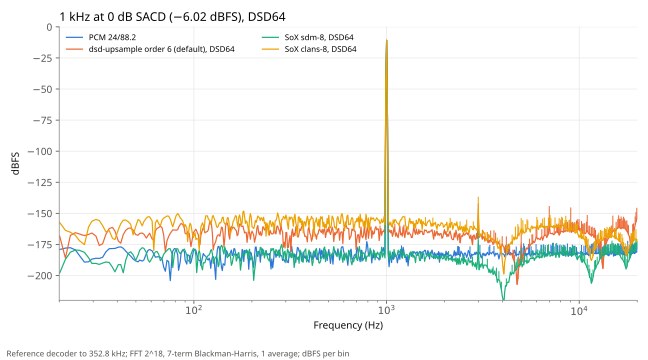

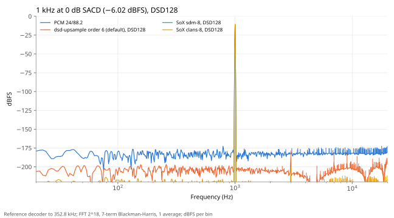

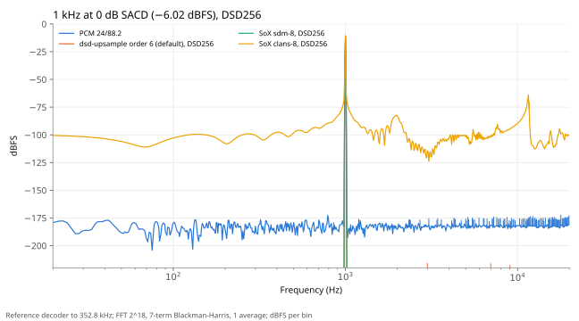

At DSD64 the default (order 6) gives a SINAD of 121.1 dB and SoX `sdm-8` 140.7 dB: at this
rate SoX's 8th-order modulator is ahead. At DSD128 the default gives 159.8 dB, SoX `sdm-8`
190.9 dB and `clans-8` 180.0 dB. At DSD256 the default reads 191.0 dB, 0.8 dB below the
limit of the 32-bit source (191.8 dB); SoX `sdm-8`, fed 6 dB hotter, reads 197.7 dB at its own source
limit. The default had no clip event in these 15 s tones at 0 dB SACD.

### Dynamic range tone, −60 dB SACD

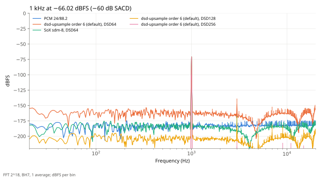

### Noise by order and by rate

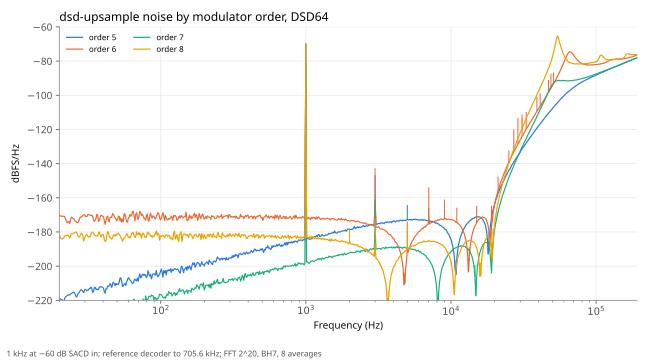

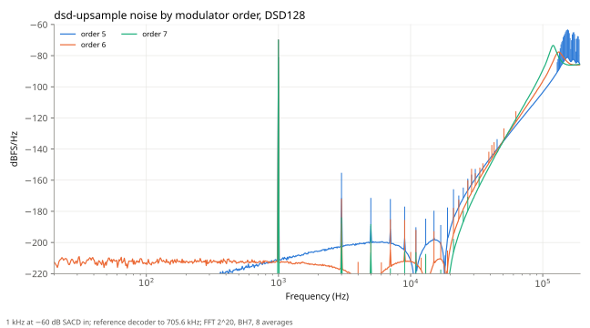

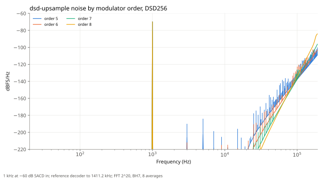

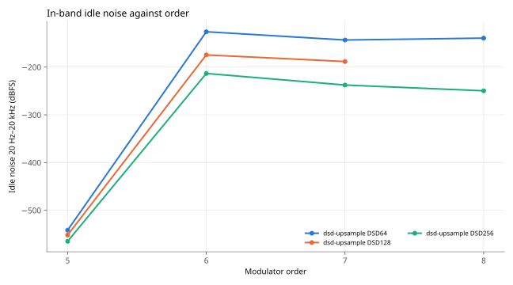

### Ultrasonic noise

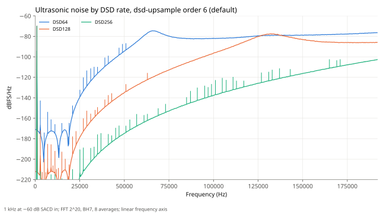

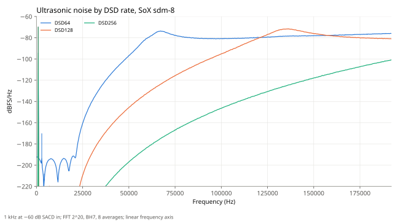

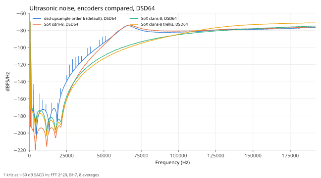

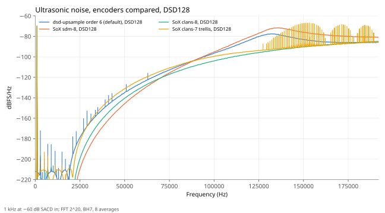

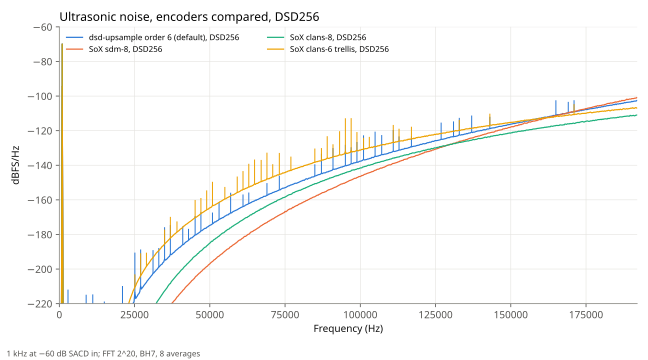

### Multitone

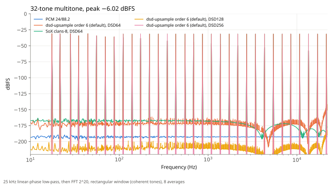

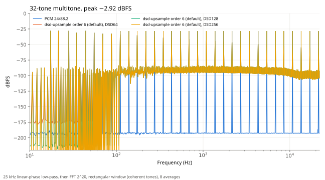

### J-Test

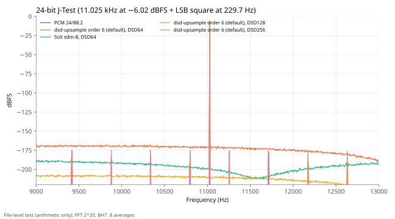

The J-Test's 11.025 kHz tone at 0 dB SACD, with the LSB square wave on top, stays below the
default limit (0.51), so nothing is limited or clipped at any order. The largest sideband
is −153.2 dBc (DSD64) and −168.0 dBc (DSD128, DSD256) at the defaults; −168.0 dBc is the
level of the 24-bit test file's own sidebands (the PCM row).

### Intermodulation

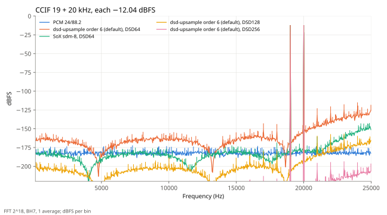

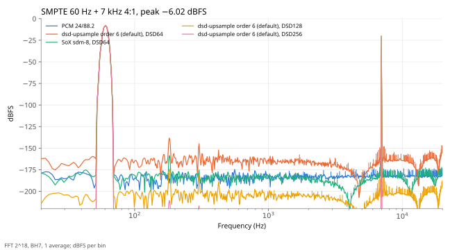

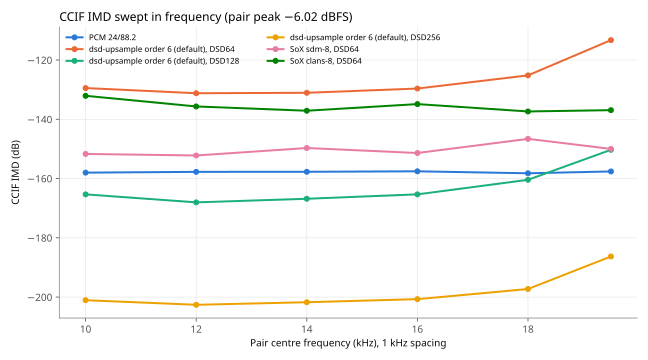

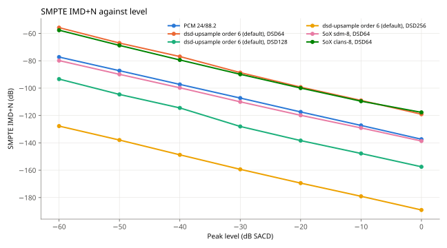

### Stability

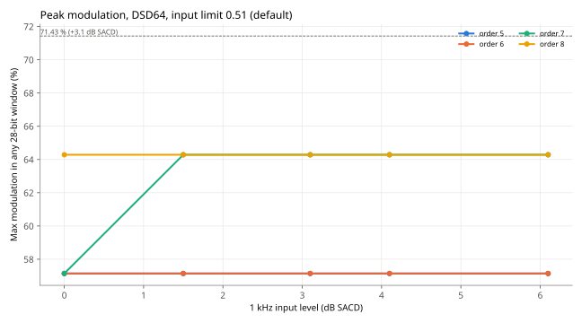

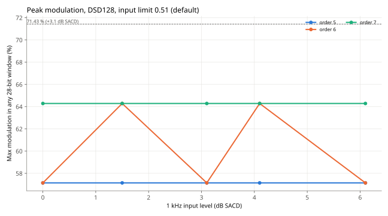

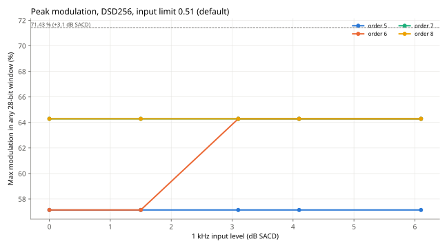

## Ultrasonic noise by rate and order

The noise of the −60 dB SACD tone above 20 kHz. "Highest density to 192 kHz" is the
maximum of the noise density averaged over 1 kHz; where the noise keeps rising past
192 kHz the maximum is at the edge, and the hump beyond it is given separately.

<!-- table:ultrasonic -->
| Encoder | Highest density to 192 kHz (kHz, dBFS/Hz) | Hump above 192 kHz (kHz, dBFS/Hz) | 22–96 kHz (dBFS) | 20–100 kHz (dBFS) | 100–192 kHz (dBFS) | Same, digital silence: 22–96 kHz (dBFS) |
|---|--:|--:|--:|--:|--:|--:|
| dsd-upsample order 5, DSD64 | 192, -77.9 | 254, -73.9 | -42.5 | -41.5 | -27.7 | -526.7 |
| dsd-upsample order 6 (default), DSD64 | 66, -74.6 | 250, -73.4 | -28.9 | -28.6 | -24.9 | -26.6 |
| dsd-upsample order 7, DSD64 | 192, -78.0 | 253, -73.8 | -39.5 | -38.9 | -27.7 | -40.9 |
| dsd-upsample order 8, DSD64 | 54, -65.4 | – | -24.4 | -24.3 | -23.6 | -24.4 |
| SoX sdm-4, DSD64 | 191, -73.4 | 256, -71.6 | -41.0 | -39.3 | -22.1 | -40.6 |
| SoX sdm-6, DSD64 | 192, -73.3 | 249, -71.6 | -28.6 | -27.5 | -20.8 | -28.0 |
| SoX sdm-8, DSD64 | 67, -73.8 | 254, -72.6 | -27.7 | -27.5 | -24.3 | -25.4 |
| SoX clans-4, DSD64 | 192, -76.6 | 254, -72.5 | -47.1 | -45.7 | -27.0 | -46.0 |
| SoX clans-5, DSD64 | 190, -76.5 | 254, -72.5 | -44.3 | -43.0 | -26.4 | -46.0 |
| SoX clans-6, DSD64 | 191, -75.6 | 253, -72.1 | -41.5 | -40.2 | -25.1 | -38.3 |
| SoX clans-7, DSD64 | 192, -76.6 | 255, -72.7 | -44.0 | -42.7 | -26.6 | -45.9 |
| SoX clans-8, DSD64 | 192, -74.8 | 250, -71.8 | -40.9 | -39.6 | -24.2 | -40.6 |
| SoX clans-8 trellis, DSD64 | 192, -71.1 | 251, -69.7 | -41.8 | -40.1 | -20.0 | -43.4 |
| dsd-upsample order 5, DSD128 | 153, -81.0 | – | -62.1 | -60.1 | -31.3 | -537.5 |
| dsd-upsample order 6 (default), DSD128 | 132, -77.5 | – | -56.4 | -53.9 | -29.1 | -62.3 |
| dsd-upsample order 7, DSD128 | 120, -73.3 | – | -50.9 | -47.7 | -27.0 | -54.1 |
| SoX sdm-4, DSD128 | 192, -89.5 | 255, -81.8 | -69.4 | -67.8 | -42.1 | -74.5 |
| SoX sdm-6, DSD128 | 192, -78.2 | 194, -78.0 | -68.0 | -65.6 | -29.5 | -72.3 |
| SoX sdm-8, DSD128 | 136, -71.7 | – | -56.5 | -53.4 | -23.3 | -60.4 |
| SoX clans-4, DSD128 | 192, -91.2 | 252, -85.3 | -68.1 | -66.6 | -42.7 | -72.6 |
| SoX clans-5, DSD128 | 192, -88.9 | 256, -83.4 | -67.0 | -65.3 | -40.6 | -71.8 |
| SoX clans-6, DSD128 | 192, -87.8 | 255, -82.5 | -65.9 | -64.1 | -39.2 | -70.1 |
| SoX clans-7, DSD128 | 192, -84.7 | 250, -82.6 | -58.8 | -57.1 | -34.7 | -61.2 |
| SoX clans-8, DSD128 | 191, -84.9 | 253, -80.8 | -62.2 | -60.2 | -35.8 | -66.1 |
| SoX clans-7 trellis, DSD128 | 192, -85.3 | 255, -80.8 | -56.9 | -55.1 | -35.5 | -69.5 |
| dsd-upsample order 5, DSD256 | 192, -108.8 | 306, -86.8 | -95.9 | -93.9 | -62.3 | -538.9 |
| dsd-upsample order 6 (default), DSD256 | 192, -102.6 | 263, -82.4 | -97.0 | -94.6 | -57.0 | -103.8 |
| dsd-upsample order 7, DSD256 | 192, -95.7 | 238, -78.0 | -97.9 | -95.2 | -51.1 | -107.5 |
| dsd-upsample order 8, DSD256 | 192, -83.7 | 213, -70.8 | -95.1 | -92.0 | -39.2 | -101.4 |
| SoX sdm-4, DSD256 | 192, -117.3 | 512, -85.9 | -97.2 | -95.6 | -69.8 | -101.7 |
| SoX sdm-6, DSD256 | 192, -113.9 | 375, -82.0 | -107.5 | -105.1 | -68.0 | -111.8 |
| SoX sdm-8, DSD256 | 192, -100.9 | 268, -74.6 | -107.7 | -104.6 | -56.1 | -111.9 |
| SoX clans-4, DSD256 | 192, -111.7 | 510, -88.2 | -91.0 | -89.4 | -64.1 | -95.5 |
| SoX clans-5, DSD256 | 192, -111.6 | 513, -89.7 | -89.0 | -87.4 | -63.5 | -91.4 |
| SoX clans-6, DSD256 | 192, -107.0 | 506, -88.0 | -88.9 | -86.9 | -59.2 | -94.4 |
| SoX clans-7, DSD256 | 192, -108.0 | 513, -87.7 | -89.1 | -87.1 | -60.0 | -91.6 |
| SoX clans-8, DSD256 | 192, -110.9 | 507, -84.9 | -101.3 | -98.8 | -64.1 | -105.4 |
| SoX clans-6 trellis, DSD256 | 191, -106.8 | 513, -88.4 | -89.3 | -87.3 | -59.2 | -100.9 |
<!-- /table -->

## Stability and overload

```sh
python tools/measure_dsdup.py run --work target/dsdmeasure --only stability,soxhold
```

Each order at each rate held a 1, 10 or 20 kHz tone for 60 s at 0, +1.5, +3.1, +4.1 and
+6.1 dB SACD, then 10 s of silence, at the default limit 0.51 and with the limiter off
(limit 1.0). "Max modulation" is the largest
modulation in any 28-bit window; "Windows beyond 71.43 %" counts 28-bit windows with more
than 24 or fewer than 4 ones.

<!-- table:stability_compact -->
| Output | Order | Limit | 1 kHz, 60 s: clip events / THD+N (dB) at 0, +1.5, +3.1, +4.1, +6.1 dB SACD | Resets, all tones and levels | Max modulation, 28-bit window, 1 kHz at +3.1 dB SACD (%) | Windows beyond 71.43 %, 1 kHz at +3.1 dB SACD |
|---|--:|--:|---|--:|--:|--:|
| DSD64 | 5 | 0.51 | 0 / -113; 0 / -24; 0 / -18; 0 / -15; 0 / -13 | 0 | 57.1 | 0 % |
| DSD64 | 5 | 1.0 | 0 / -113; 0 / -114; 130142 / -43; 16629645 / -21; 47651601 / -21 | 2502327 | 100.0 | 0.948 % |
| DSD64 | 6 | 0.51 | 0 / -121; 0 / -24; 0 / -18; 0 / -15; 0 / -13 | 0 | 57.1 | 0 % |
| DSD64 | 6 | 1.0 | 0 / -121; 0 / -122; 53235 / -37; 16156324 / -19; 44617714 / -19 | 3049633 | 100.0 | 0.918 % |
| DSD64 | 7 | 0.51 | 0 / -129; 0 / -24; 0 / -18; 0 / -15; 0 / -13 | 0 | 64.3 | 0 % |
| DSD64 | 7 | 1.0 | 0 / -129; 0 / -130; 167015 / -36; 16207610 / -17; 44747099 / -19 | 3171312 | 100.0 | 1.19 % |
| DSD64 | 8 | 0.51 | 0 / -134; 0 / -24; 0 / -18; 0 / -15; 0 / -13 | 0 | 64.3 | 0 % |
| DSD64 | 8 | 1.0 | 0 / -134; 0 / -136; 47895 / -40; 13943095 / -16; 44039906 / -18 | 3249518 | 100.0 | 1.2 % |
| DSD128 | 5 | 0.51 | 0 / -146; 0 / -24; 0 / -18; 0 / -15; 0 / -13 | 0 | 57.1 | 0 % |
| DSD128 | 5 | 1.0 | 0 / -146; 0 / -147; 521425 / -46; 33517893 / -30; 95264503 / -30 | 5991036 | 100.0 | 1.04 % |
| DSD128 | 6 | 0.51 | 0 / -160; 0 / -24; 0 / -18; 0 / -15; 0 / -13 | 0 | 57.1 | 0 % |
| DSD128 | 6 | 1.0 | 0 / -160; 0 / -161; 409211 / -42; 36790081 / -26; 98690858 / -26 | 6066103 | 100.0 | 1.11 % |
| DSD128 | 7 | 0.51 | 0 / -173; 0 / -24; 0 / -18; 0 / -15; 0 / -13 | 0 | 64.3 | 0 % |
| DSD128 | 7 | 1.0 | 0 / -173; 0 / -174; 1274382 / -37; 38236435 / -22; 96692824 / -26 | 6566088 | 100.0 | 1.64 % |
| DSD256 | 5 | 0.51 | 0 / -178; 0 / -24; 0 / -18; 0 / -15; 0 / -13 | 0 | 57.1 | 0 % |
| DSD256 | 5 | 1.0 | 0 / -178; 0 / -179; 8893159 / -39; 141369689 / -34; 210025106 / -34 | 7133745 | 100.0 | 1.69 % |
| DSD256 | 6 | 0.51 | 0 / -191; 0 / -24; 0 / -18; 0 / -15; 0 / -13 | 0 | 64.3 | 0 % |
| DSD256 | 6 | 1.0 | 0 / -191; 0 / -192; 5439996 / -41; 102115267 / -33; 281830526 / -34 | 8188012 | 100.0 | 1.58 % |
| DSD256 | 7 | 0.51 | 0 / -192; 0 / -24; 0 / -18; 0 / -15; 0 / -13 | 0 | 64.3 | 0 % |
| DSD256 | 7 | 1.0 | 0 / -192; 0 / -193; 3346193 / -38; 78448006 / -25; 191450174 / -28 | 11372647 | 100.0 | 1.8 % |
| DSD256 | 8 | 0.51 | 0 / -192; 0 / -24; 0 / -18; 0 / -15; 0 / -13 | 0 | 64.3 | 0 % |
| DSD256 | 8 | 1.0 | 0 / -192; 0 / -193; 2125861 / -38; 69327956 / -23; 185123053 / -25 | 11268560 | 100.0 | 1.88 % |
<!-- /table -->

- **dsd-upsample, default limit 0.51.** No order at any rate clipped a
  state or needed a reset in any of the 15 holds (165 runs of 60 s), and no 28-bit window
  went beyond 71.43 % (at most 64.3 %). Above 0 dB SACD the THD+N of the 1 kHz tone is that
  of the hard-limited sine (−24 to −13 dB).
- **dsd-upsample, limiter off (limit 1.0).** Every order clipped and
  needed between 2.5 and 11.4 million resets over the 15 holds, and with the 1 kHz tone at
  +3.1 dB SACD 0.92 % to 1.88 % of the 28-bit windows went beyond 71.43 %: the limit is what keeps the
  modulator stable on input above full scale.
- **SoX-DSD at 0 dB SACD** (the most it accepts from PCM). sdm-4 and clans-4 at all
  three rates, sdm-8 at DSD64 and DSD128, and clans-8 at DSD128 held all three tones for
  60 s with no 28-bit window beyond 71.43 %. sdm-8 at DSD256 and clans-8 at DSD64 and DSD256 did not: in 8 of
  their 9 holds the output stopped switching for 79.8 million to 663 million bits (7 to
  59 s), and in 7 of them THD+N over the last 10 s was between −57.4 and +39.2 dB. This
  matches Archimago's report that SoX's sdm-8 became unstable on a long, loud static tone.

<details><summary>All stability runs</summary>

<!-- table:stability -->
| Encoder | Limit | Level (dB SACD) | Freq (kHz) | Limited | Clipped | Resets | Max modulation, 28-bit window (%) | Windows beyond 71.43 % | Longest run (bits) | THD+N first / last 10 s (dB) | Recovery (ms) |
|---|--:|--:|--:|--:|--:|--:|--:|--:|--:|--:|--:|
| dsd-upsample order 5, DSD128 | 0.51 | +0.0 | 1 | 106 | 0 | 0 | 57.1 | 0 % | 6 | -145.6 / -145.4 | 0 |
| dsd-upsample order 5, DSD128 | 0.51 | +0.0 | 10 | 17 | 0 | 0 | 57.1 | 0 % | 6 | -146.5 / -146.5 | 0 |
| dsd-upsample order 5, DSD128 | 0.51 | +0.0 | 20 | 0 | 0 | 0 | 57.1 | 0 % | 6 | -146.7 / -146.8 | 1850 |
| dsd-upsample order 5, DSD128 | 0.51 | +1.5 | 1 | 116592009 | 0 | 0 | 57.1 | 0 % | 7 | -24.2 / -24.2 | 0 |
| dsd-upsample order 5, DSD128 | 0.51 | +1.5 | 10 | 116591817 | 0 | 0 | 57.1 | 0 % | 7 | -112.6 / -112.6 | 0 |
| dsd-upsample order 5, DSD128 | 0.51 | +1.5 | 20 | 116591916 | 0 | 0 | 57.1 | 0 % | 7 | -111.3 / -111.3 | 0 |
| dsd-upsample order 5, DSD128 | 0.51 | +3.1 | 1 | 168404492 | 0 | 0 | 57.1 | 0 % | 7 | -17.7 / -17.7 | 0 |
| dsd-upsample order 5, DSD128 | 0.51 | +3.1 | 10 | 168404929 | 0 | 0 | 57.1 | 0 % | 7 | -109.0 / -109.0 | 0 |
| dsd-upsample order 5, DSD128 | 0.51 | +3.1 | 20 | 168404406 | 0 | 0 | 57.1 | 0 % | 7 | -97.9 / -97.9 | > 2000 |
| dsd-upsample order 5, DSD128 | 0.51 | +4.1 | 1 | 191655971 | 0 | 0 | 57.1 | 0 % | 7 | -15.5 / -15.5 | 200 |
| dsd-upsample order 5, DSD128 | 0.51 | +4.1 | 10 | 191655392 | 0 | 0 | 57.1 | 0 % | 7 | -107.6 / -107.6 | 0 |
| dsd-upsample order 5, DSD128 | 0.51 | +4.1 | 20 | 191655623 | 0 | 0 | 57.1 | 0 % | 7 | -104.5 / -104.5 | 0 |
| dsd-upsample order 5, DSD128 | 0.51 | +6.1 | 1 | 227195480 | 0 | 0 | 57.1 | 0 % | 7 | -12.8 / -12.8 | 0 |
| dsd-upsample order 5, DSD128 | 0.51 | +6.1 | 10 | 227324191 | 0 | 0 | 57.1 | 0 % | 7 | -73.8 / -73.8 | 0 |
| dsd-upsample order 5, DSD128 | 0.51 | +6.1 | 20 | 227065888 | 0 | 0 | 57.1 | 0 % | 7 | -74.7 / -74.7 | 0 |
| dsd-upsample order 5, DSD128 | 1.0 | +0.0 | 1 | 0 | 0 | 0 | 57.1 | 0 % | 6 | -145.6 / -145.4 | 0 |
| dsd-upsample order 5, DSD128 | 1.0 | +0.0 | 10 | 0 | 0 | 0 | 57.1 | 0 % | 6 | -146.5 / -146.5 | 0 |
| dsd-upsample order 5, DSD128 | 1.0 | +0.0 | 20 | 0 | 0 | 0 | 57.1 | 0 % | 6 | -146.7 / -146.8 | 1850 |
| dsd-upsample order 5, DSD128 | 1.0 | +1.5 | 1 | 0 | 0 | 0 | 71.4 | 0 % | 9 | -146.9 / -146.7 | 0 |
| dsd-upsample order 5, DSD128 | 1.0 | +1.5 | 10 | 0 | 0 | 0 | 64.3 | 0 % | 9 | -148.1 / -148.3 | 0 |
| dsd-upsample order 5, DSD128 | 1.0 | +1.5 | 20 | 0 | 0 | 0 | 64.3 | 0 % | 9 | -147.6 / -147.6 | 0 |
| dsd-upsample order 5, DSD128 | 1.0 | +3.1 | 1 | 0 | 521425 | 6475 | 100.0 | 1.04 % | 69 | -45.6 / -47.1 | 0 |
| dsd-upsample order 5, DSD128 | 1.0 | +3.1 | 10 | 0 | 21159 | 282 | 100.0 | 0.681 % | 42 | -90.1 / -149.0 | 0 |
| dsd-upsample order 5, DSD128 | 1.0 | +3.1 | 20 | 0 | 0 | 0 | 78.6 | 0.25 % | 16 | -149.2 / -149.3 | 0 |
| dsd-upsample order 5, DSD128 | 1.0 | +4.1 | 1 | 0 | 33517893 | 392989 | 100.0 | 18.2 % | 80 | -29.6 / -29.6 | 0 |
| dsd-upsample order 5, DSD128 | 1.0 | +4.1 | 10 | 0 | 43186648 | 552526 | 100.0 | 23.5 % | 64 | -28.2 / -28.2 | 1950 |
| dsd-upsample order 5, DSD128 | 1.0 | +4.1 | 20 | 0 | 8302520 | 109691 | 100.0 | 18.8 % | 70 | -36.2 / -36.1 | 0 |
| dsd-upsample order 5, DSD128 | 1.0 | +6.1 | 1 | 15420678 | 95264503 | 1195795 | 100.0 | 42.3 % | 206 | -29.5 / -29.4 | 1950 |
| dsd-upsample order 5, DSD128 | 1.0 | +6.1 | 10 | 24334379 | 96604127 | 1357237 | 100.0 | 47.3 % | 101 | -31.9 / -31.9 | 1000 |
| dsd-upsample order 5, DSD128 | 1.0 | +6.1 | 20 | 26925023 | 186071420 | 2376041 | 100.0 | 55.7 % | 78 | -23.9 / -24.0 | 0 |
| dsd-upsample order 5, DSD256 | 0.51 | +0.0 | 1 | 212 | 0 | 0 | 57.1 | 0 % | 7 | -177.6 / -177.6 | 0 |
| dsd-upsample order 5, DSD256 | 0.51 | +0.0 | 10 | 35 | 0 | 0 | 57.1 | 0 % | 7 | -179.5 / -179.3 | 0 |
| dsd-upsample order 5, DSD256 | 0.51 | +0.0 | 20 | 0 | 0 | 0 | 57.1 | 0 % | 6 | -179.3 / -179.2 | 0 |
| dsd-upsample order 5, DSD256 | 0.51 | +1.5 | 1 | 233183859 | 0 | 0 | 57.1 | 0 % | 7 | -24.2 / -24.2 | 0 |
| dsd-upsample order 5, DSD256 | 0.51 | +1.5 | 10 | 233183943 | 0 | 0 | 57.1 | 0 % | 7 | -123.8 / -123.8 | 0 |
| dsd-upsample order 5, DSD256 | 0.51 | +1.5 | 20 | 233183678 | 0 | 0 | 57.1 | 0 % | 7 | -113.3 / -113.3 | 0 |
| dsd-upsample order 5, DSD256 | 0.51 | +3.1 | 1 | 336809134 | 0 | 0 | 57.1 | 0 % | 7 | -17.7 / -17.7 | 0 |
| dsd-upsample order 5, DSD256 | 0.51 | +3.1 | 10 | 336809525 | 0 | 0 | 57.1 | 0 % | 7 | -121.0 / -121.0 | 1800 |
| dsd-upsample order 5, DSD256 | 0.51 | +3.1 | 20 | 336808979 | 0 | 0 | 57.1 | 0 % | 7 | -121.2 / -121.2 | 0 |
| dsd-upsample order 5, DSD256 | 0.51 | +4.1 | 1 | 383311821 | 0 | 0 | 57.1 | 0 % | 7 | -15.5 / -15.5 | 0 |
| dsd-upsample order 5, DSD256 | 0.51 | +4.1 | 10 | 383311105 | 0 | 0 | 57.1 | 0 % | 7 | -120.2 / -120.2 | 0 |
| dsd-upsample order 5, DSD256 | 0.51 | +4.1 | 20 | 383311386 | 0 | 0 | 57.1 | 0 % | 7 | -121.9 / -121.9 | 0 |
| dsd-upsample order 5, DSD256 | 0.51 | +6.1 | 1 | 454391141 | 0 | 0 | 57.1 | 0 % | 7 | -12.8 / -12.8 | 0 |
| dsd-upsample order 5, DSD256 | 0.51 | +6.1 | 10 | 454647389 | 0 | 0 | 57.1 | 0 % | 7 | -73.8 / -73.8 | 0 |
| dsd-upsample order 5, DSD256 | 0.51 | +6.1 | 20 | 454131305 | 0 | 0 | 57.1 | 0 % | 7 | -74.7 / -74.7 | 0 |
| dsd-upsample order 5, DSD256 | 1.0 | +0.0 | 1 | 0 | 0 | 0 | 64.3 | 0 % | 7 | -177.6 / -177.6 | 0 |
| dsd-upsample order 5, DSD256 | 1.0 | +0.0 | 10 | 0 | 0 | 0 | 57.1 | 0 % | 7 | -179.5 / -179.3 | 0 |
| dsd-upsample order 5, DSD256 | 1.0 | +0.0 | 20 | 0 | 0 | 0 | 57.1 | 0 % | 6 | -179.3 / -179.2 | 0 |
| dsd-upsample order 5, DSD256 | 1.0 | +1.5 | 1 | 0 | 0 | 0 | 71.4 | 0 % | 9 | -178.6 / -178.6 | 0 |
| dsd-upsample order 5, DSD256 | 1.0 | +1.5 | 10 | 0 | 0 | 0 | 71.4 | 0 % | 9 | -181.0 / -180.8 | 0 |
| dsd-upsample order 5, DSD256 | 1.0 | +1.5 | 20 | 0 | 0 | 0 | 71.4 | 0 % | 9 | -181.0 / -180.7 | 0 |
| dsd-upsample order 5, DSD256 | 1.0 | +3.1 | 1 | 0 | 8893159 | 0 | 100.0 | 1.69 % | 56 | -39.0 / -40.7 | 0 |
| dsd-upsample order 5, DSD256 | 1.0 | +3.1 | 10 | 0 | 734234 | 0 | 100.0 | 0.922 % | 56 | -48.1 / -51.6 | 0 |
| dsd-upsample order 5, DSD256 | 1.0 | +3.1 | 20 | 0 | 48168 | 0 | 100.0 | 0.692 % | 54 | -73.5 / -70.4 | 0 |
| dsd-upsample order 5, DSD256 | 1.0 | +4.1 | 1 | 0 | 141369689 | 187428 | 100.0 | 19.3 % | 77 | -33.9 / -33.9 | 0 |
| dsd-upsample order 5, DSD256 | 1.0 | +4.1 | 10 | 0 | 135908561 | 62489 | 100.0 | 23.4 % | 73 | -32.9 / -32.9 | 0 |
| dsd-upsample order 5, DSD256 | 1.0 | +4.1 | 20 | 0 | 103895926 | 31698 | 100.0 | 23.1 % | 71 | -34.0 / -34.2 | 0 |
| dsd-upsample order 5, DSD256 | 1.0 | +6.1 | 1 | 30850706 | 210025106 | 2224299 | 100.0 | 44 % | 283 | -33.8 / -33.8 | 0 |
| dsd-upsample order 5, DSD256 | 1.0 | +6.1 | 10 | 48618690 | 183872674 | 2261039 | 100.0 | 45 % | 149 | -38.0 / -38.0 | 1200 |
| dsd-upsample order 5, DSD256 | 1.0 | +6.1 | 20 | 53758127 | 199837792 | 2366792 | 100.0 | 46.5 % | 107 | -37.4 / -37.3 | 0 |
| dsd-upsample order 5, DSD64 | 0.51 | +0.0 | 1 | 53 | 0 | 0 | 57.1 | 0 % | 6 | -112.8 / -112.8 | 0 |
| dsd-upsample order 5, DSD64 | 0.51 | +0.0 | 10 | 9 | 0 | 0 | 57.1 | 0 % | 6 | -113.6 / -113.5 | 0 |
| dsd-upsample order 5, DSD64 | 0.51 | +0.0 | 20 | 0 | 0 | 0 | 57.1 | 0 % | 6 | -113.8 / -113.8 | 0 |
| dsd-upsample order 5, DSD64 | 0.51 | +1.5 | 1 | 58295913 | 0 | 0 | 57.1 | 0 % | 7 | -24.2 / -24.2 | 0 |
| dsd-upsample order 5, DSD64 | 0.51 | +1.5 | 10 | 58296067 | 0 | 0 | 57.1 | 0 % | 7 | -102.2 / -102.2 | 0 |
| dsd-upsample order 5, DSD64 | 0.51 | +1.5 | 20 | 58295874 | 0 | 0 | 57.1 | 0 % | 7 | -90.8 / -90.8 | 0 |
| dsd-upsample order 5, DSD64 | 0.51 | +3.1 | 1 | 84202158 | 0 | 0 | 57.1 | 0 % | 7 | -17.7 / -17.7 | 0 |
| dsd-upsample order 5, DSD64 | 0.51 | +3.1 | 10 | 84202303 | 0 | 0 | 57.1 | 0 % | 7 | -97.0 / -97.0 | 0 |
| dsd-upsample order 5, DSD64 | 0.51 | +3.1 | 20 | 84202107 | 0 | 0 | 57.1 | 0 % | 7 | -86.4 / -86.4 | 0 |
| dsd-upsample order 5, DSD64 | 0.51 | +4.1 | 1 | 95828046 | 0 | 0 | 57.1 | 0 % | 7 | -15.5 / -15.5 | 0 |
| dsd-upsample order 5, DSD64 | 0.51 | +4.1 | 10 | 95827860 | 0 | 0 | 57.1 | 0 % | 7 | -95.9 / -95.9 | 0 |
| dsd-upsample order 5, DSD64 | 0.51 | +4.1 | 20 | 95827724 | 0 | 0 | 57.1 | 0 % | 7 | -97.7 / -97.7 | > 2000 |
| dsd-upsample order 5, DSD64 | 0.51 | +6.1 | 1 | 113597484 | 0 | 0 | 57.1 | 0 % | 7 | -12.8 / -12.8 | 0 |
| dsd-upsample order 5, DSD64 | 0.51 | +6.1 | 10 | 113662261 | 0 | 0 | 57.1 | 0 % | 7 | -73.8 / -73.8 | 0 |
| dsd-upsample order 5, DSD64 | 0.51 | +6.1 | 20 | 113532891 | 0 | 0 | 57.1 | 0 % | 7 | -74.3 / -74.3 | 0 |
| dsd-upsample order 5, DSD64 | 1.0 | +0.0 | 1 | 0 | 0 | 0 | 57.1 | 0 % | 6 | -112.8 / -112.8 | 0 |
| dsd-upsample order 5, DSD64 | 1.0 | +0.0 | 10 | 0 | 0 | 0 | 57.1 | 0 % | 6 | -113.6 / -113.5 | 0 |
| dsd-upsample order 5, DSD64 | 1.0 | +0.0 | 20 | 0 | 0 | 0 | 57.1 | 0 % | 6 | -113.8 / -113.8 | 0 |
| dsd-upsample order 5, DSD64 | 1.0 | +1.5 | 1 | 0 | 0 | 0 | 71.4 | 0 % | 8 | -114.2 / -114.5 | 0 |
| dsd-upsample order 5, DSD64 | 1.0 | +1.5 | 10 | 0 | 0 | 0 | 64.3 | 0 % | 9 | -114.9 / -114.8 | 0 |
| dsd-upsample order 5, DSD64 | 1.0 | +1.5 | 20 | 0 | 0 | 0 | 64.3 | 0 % | 8 | -115.5 / -115.3 | 550 |
| dsd-upsample order 5, DSD64 | 1.0 | +3.1 | 1 | 0 | 130142 | 1525 | 100.0 | 0.948 % | 72 | -43.2 / -42.4 | 0 |
| dsd-upsample order 5, DSD64 | 1.0 | +3.1 | 10 | 0 | 0 | 0 | 78.6 | 0.23 % | 16 | -116.4 / -116.1 | 0 |
| dsd-upsample order 5, DSD64 | 1.0 | +3.1 | 20 | 0 | 0 | 0 | 78.6 | 0.000119 % | 13 | -116.4 / -116.7 | 0 |
| dsd-upsample order 5, DSD64 | 1.0 | +4.1 | 1 | 0 | 16629645 | 172677 | 100.0 | 19.6 % | 79 | -20.9 / -20.8 | 0 |
| dsd-upsample order 5, DSD64 | 1.0 | +4.1 | 10 | 0 | 3212008 | 33646 | 100.0 | 18.9 % | 69 | -30.2 / -30.5 | 0 |
| dsd-upsample order 5, DSD64 | 1.0 | +4.1 | 20 | 0 | 140 | 2 | 100.0 | 6.73 % | 62 | -113.6 / -113.3 | 400 |
| dsd-upsample order 5, DSD64 | 1.0 | +6.1 | 1 | 7709368 | 47651601 | 595522 | 100.0 | 44 % | 184 | -20.7 / -20.5 | 0 |
| dsd-upsample order 5, DSD64 | 1.0 | +6.1 | 10 | 12206449 | 94214526 | 779504 | 100.0 | 52.5 % | 80 | -21.7 / -21.7 | 0 |
| dsd-upsample order 5, DSD64 | 1.0 | +6.1 | 20 | 13535282 | 105271427 | 919451 | 100.0 | 49.9 % | 70 | -14.2 / -14.1 | 0 |
| dsd-upsample order 6 (default), DSD128 | 0.51 | +0.0 | 1 | 106 | 0 | 0 | 57.1 | 0 % | 7 | -159.8 / -159.9 | 1250 |
| dsd-upsample order 6 (default), DSD128 | 0.51 | +0.0 | 10 | 17 | 0 | 0 | 57.1 | 0 % | 6 | -160.5 / -160.5 | > 2000 |
| dsd-upsample order 6 (default), DSD128 | 0.51 | +0.0 | 20 | 0 | 0 | 0 | 57.1 | 0 % | 7 | -160.6 / -160.5 | 0 |
| dsd-upsample order 6 (default), DSD128 | 0.51 | +1.5 | 1 | 116592009 | 0 | 0 | 64.3 | 0 % | 7 | -24.2 / -24.2 | > 2000 |
| dsd-upsample order 6 (default), DSD128 | 0.51 | +1.5 | 10 | 116591817 | 0 | 0 | 57.1 | 0 % | 7 | -112.6 / -112.6 | > 2000 |
| dsd-upsample order 6 (default), DSD128 | 0.51 | +1.5 | 20 | 116591916 | 0 | 0 | 64.3 | 0 % | 7 | -111.3 / -111.3 | 0 |
| dsd-upsample order 6 (default), DSD128 | 0.51 | +3.1 | 1 | 168404492 | 0 | 0 | 57.1 | 0 % | 7 | -17.7 / -17.7 | > 2000 |
| dsd-upsample order 6 (default), DSD128 | 0.51 | +3.1 | 10 | 168404929 | 0 | 0 | 64.3 | 0 % | 7 | -109.0 / -109.0 | 1800 |
| dsd-upsample order 6 (default), DSD128 | 0.51 | +3.1 | 20 | 168404406 | 0 | 0 | 64.3 | 0 % | 7 | -97.9 / -97.9 | 1800 |
| dsd-upsample order 6 (default), DSD128 | 0.51 | +4.1 | 1 | 191655971 | 0 | 0 | 64.3 | 0 % | 7 | -15.5 / -15.5 | 1950 |
| dsd-upsample order 6 (default), DSD128 | 0.51 | +4.1 | 10 | 191655392 | 0 | 0 | 57.1 | 0 % | 7 | -107.6 / -107.6 | 0 |
| dsd-upsample order 6 (default), DSD128 | 0.51 | +4.1 | 20 | 191655623 | 0 | 0 | 57.1 | 0 % | 7 | -104.5 / -104.5 | 0 |
| dsd-upsample order 6 (default), DSD128 | 0.51 | +6.1 | 1 | 227195480 | 0 | 0 | 57.1 | 0 % | 7 | -12.8 / -12.8 | 0 |
| dsd-upsample order 6 (default), DSD128 | 0.51 | +6.1 | 10 | 227324191 | 0 | 0 | 57.1 | 0 % | 7 | -73.8 / -73.8 | > 2000 |
| dsd-upsample order 6 (default), DSD128 | 0.51 | +6.1 | 20 | 227065888 | 0 | 0 | 64.3 | 0 % | 7 | -74.7 / -74.7 | 0 |
| dsd-upsample order 6 (default), DSD128 | 1.0 | +0.0 | 1 | 0 | 0 | 0 | 57.1 | 0 % | 7 | -159.8 / -159.9 | > 2000 |
| dsd-upsample order 6 (default), DSD128 | 1.0 | +0.0 | 10 | 0 | 0 | 0 | 57.1 | 0 % | 6 | -160.5 / -160.5 | 0 |
| dsd-upsample order 6 (default), DSD128 | 1.0 | +0.0 | 20 | 0 | 0 | 0 | 57.1 | 0 % | 7 | -160.6 / -160.5 | 0 |
| dsd-upsample order 6 (default), DSD128 | 1.0 | +1.5 | 1 | 0 | 0 | 0 | 71.4 | 0 % | 10 | -161.0 / -161.1 | > 2000 |
| dsd-upsample order 6 (default), DSD128 | 1.0 | +1.5 | 10 | 0 | 0 | 0 | 71.4 | 0 % | 9 | -162.3 / -162.4 | 0 |
| dsd-upsample order 6 (default), DSD128 | 1.0 | +1.5 | 20 | 0 | 0 | 0 | 71.4 | 0 % | 9 | -161.6 / -161.6 | > 2000 |
| dsd-upsample order 6 (default), DSD128 | 1.0 | +3.1 | 1 | 0 | 409211 | 5668 | 100.0 | 1.11 % | 78 | -42.2 / -40.7 | > 2000 |
| dsd-upsample order 6 (default), DSD128 | 1.0 | +3.1 | 10 | 0 | 7260 | 102 | 100.0 | 0.693 % | 55 | -60.1 / -62.4 | > 2000 |
| dsd-upsample order 6 (default), DSD128 | 1.0 | +3.1 | 20 | 0 | 0 | 0 | 85.7 | 0.261 % | 20 | -163.1 / -163.4 | 0 |
| dsd-upsample order 6 (default), DSD128 | 1.0 | +4.1 | 1 | 0 | 36790081 | 436773 | 100.0 | 17.9 % | 82 | -25.8 / -25.6 | 0 |
| dsd-upsample order 6 (default), DSD128 | 1.0 | +4.1 | 10 | 0 | 35610731 | 478671 | 100.0 | 24.1 % | 76 | -24.8 / -24.8 | > 2000 |
| dsd-upsample order 6 (default), DSD128 | 1.0 | +4.1 | 20 | 0 | 8160295 | 113377 | 100.0 | 18.9 % | 76 | -34.5 / -35.5 | 1800 |
| dsd-upsample order 6 (default), DSD128 | 1.0 | +6.1 | 1 | 15420678 | 98690858 | 1288858 | 100.0 | 42.4 % | 207 | -25.6 / -25.5 | 1800 |
| dsd-upsample order 6 (default), DSD128 | 1.0 | +6.1 | 10 | 24334379 | 95254309 | 1349509 | 100.0 | 46.6 % | 105 | -31.3 / -31.2 | 700 |
| dsd-upsample order 6 (default), DSD128 | 1.0 | +6.1 | 20 | 26925023 | 175091241 | 2393145 | 100.0 | 57.8 % | 80 | -23.7 / -23.6 | > 2000 |
| dsd-upsample order 6 (default), DSD256 | 0.51 | +0.0 | 1 | 212 | 0 | 0 | 57.1 | 0 % | 6 | -191.0 / -191.0 | 0 |
| dsd-upsample order 6 (default), DSD256 | 0.51 | +0.0 | 10 | 35 | 0 | 0 | 57.1 | 0 % | 6 | -191.3 / -190.4 | > 2000 |
| dsd-upsample order 6 (default), DSD256 | 0.51 | +0.0 | 20 | 0 | 0 | 0 | 57.1 | 0 % | 7 | -191.0 / -188.4 | 0 |
| dsd-upsample order 6 (default), DSD256 | 0.51 | +1.5 | 1 | 233183859 | 0 | 0 | 57.1 | 0 % | 7 | -24.2 / -24.2 | 0 |
| dsd-upsample order 6 (default), DSD256 | 0.51 | +1.5 | 10 | 233183943 | 0 | 0 | 64.3 | 0 % | 7 | -123.8 / -123.8 | 50 |
| dsd-upsample order 6 (default), DSD256 | 0.51 | +1.5 | 20 | 233183678 | 0 | 0 | 64.3 | 0 % | 7 | -113.3 / -113.3 | 0 |
| dsd-upsample order 6 (default), DSD256 | 0.51 | +3.1 | 1 | 336809134 | 0 | 0 | 64.3 | 0 % | 7 | -17.7 / -17.7 | > 2000 |
| dsd-upsample order 6 (default), DSD256 | 0.51 | +3.1 | 10 | 336809525 | 0 | 0 | 64.3 | 0 % | 7 | -121.0 / -121.0 | 0 |
| dsd-upsample order 6 (default), DSD256 | 0.51 | +3.1 | 20 | 336808979 | 0 | 0 | 57.1 | 0 % | 7 | -121.2 / -121.2 | 0 |
| dsd-upsample order 6 (default), DSD256 | 0.51 | +4.1 | 1 | 383311821 | 0 | 0 | 64.3 | 0 % | 7 | -15.5 / -15.5 | 0 |
| dsd-upsample order 6 (default), DSD256 | 0.51 | +4.1 | 10 | 383311105 | 0 | 0 | 64.3 | 0 % | 7 | -120.2 / -120.2 | 0 |
| dsd-upsample order 6 (default), DSD256 | 0.51 | +4.1 | 20 | 383311386 | 0 | 0 | 57.1 | 0 % | 7 | -121.9 / -121.9 | 0 |
| dsd-upsample order 6 (default), DSD256 | 0.51 | +6.1 | 1 | 454391141 | 0 | 0 | 64.3 | 0 % | 7 | -12.8 / -12.8 | 0 |
| dsd-upsample order 6 (default), DSD256 | 0.51 | +6.1 | 10 | 454647389 | 0 | 0 | 57.1 | 0 % | 7 | -73.8 / -73.8 | 0 |
| dsd-upsample order 6 (default), DSD256 | 0.51 | +6.1 | 20 | 454131305 | 0 | 0 | 64.3 | 0 % | 7 | -74.7 / -74.7 | 0 |
| dsd-upsample order 6 (default), DSD256 | 1.0 | +0.0 | 1 | 0 | 0 | 0 | 57.1 | 0 % | 6 | -191.0 / -191.0 | 0 |
| dsd-upsample order 6 (default), DSD256 | 1.0 | +0.0 | 10 | 0 | 0 | 0 | 57.1 | 0 % | 6 | -191.3 / -190.4 | 0 |
| dsd-upsample order 6 (default), DSD256 | 1.0 | +0.0 | 20 | 0 | 0 | 0 | 57.1 | 0 % | 7 | -191.0 / -188.4 | 0 |
| dsd-upsample order 6 (default), DSD256 | 1.0 | +1.5 | 1 | 0 | 0 | 0 | 71.4 | 0 % | 9 | -192.4 / -192.5 | 0 |
| dsd-upsample order 6 (default), DSD256 | 1.0 | +1.5 | 10 | 0 | 0 | 0 | 71.4 | 0 % | 10 | -192.7 / -191.7 | 0 |
| dsd-upsample order 6 (default), DSD256 | 1.0 | +1.5 | 20 | 0 | 0 | 0 | 71.4 | 0 % | 9 | -192.7 / -189.1 | 0 |
| dsd-upsample order 6 (default), DSD256 | 1.0 | +3.1 | 1 | 0 | 5439996 | 8164 | 100.0 | 1.58 % | 73 | -41.3 / -42.2 | > 2000 |
| dsd-upsample order 6 (default), DSD256 | 1.0 | +3.1 | 10 | 0 | 845462 | 284 | 100.0 | 0.99 % | 72 | -52.5 / -49.5 | 0 |
| dsd-upsample order 6 (default), DSD256 | 1.0 | +3.1 | 20 | 0 | 61070 | 16 | 100.0 | 0.716 % | 70 | -66.3 / -64.8 | 0 |
| dsd-upsample order 6 (default), DSD256 | 1.0 | +4.1 | 1 | 0 | 102115267 | 514952 | 100.0 | 18.8 % | 83 | -33.3 / -33.6 | 0 |
| dsd-upsample order 6 (default), DSD256 | 1.0 | +4.1 | 10 | 0 | 231177688 | 324365 | 100.0 | 24.7 % | 83 | -32.8 / -32.9 | 0 |
| dsd-upsample order 6 (default), DSD256 | 1.0 | +4.1 | 20 | 0 | 129516627 | 253503 | 100.0 | 24.7 % | 81 | -32.4 / -32.6 | 0 |
| dsd-upsample order 6 (default), DSD256 | 1.0 | +6.1 | 1 | 30850706 | 281830526 | 2342063 | 100.0 | 43.8 % | 279 | -33.9 / -34.0 | 0 |
| dsd-upsample order 6 (default), DSD256 | 1.0 | +6.1 | 10 | 48618690 | 270708439 | 2333277 | 100.0 | 45.2 % | 151 | -36.5 / -36.6 | 0 |
| dsd-upsample order 6 (default), DSD256 | 1.0 | +6.1 | 20 | 53758127 | 213071533 | 2411388 | 100.0 | 46.2 % | 112 | -37.0 / -36.9 | 0 |
| dsd-upsample order 6 (default), DSD64 | 0.51 | +0.0 | 1 | 53 | 0 | 0 | 57.1 | 0 % | 6 | -121.1 / -121.0 | 100 |
| dsd-upsample order 6 (default), DSD64 | 0.51 | +0.0 | 10 | 9 | 0 | 0 | 57.1 | 0 % | 6 | -121.1 / -121.6 | 200 |
| dsd-upsample order 6 (default), DSD64 | 0.51 | +0.0 | 20 | 0 | 0 | 0 | 57.1 | 0 % | 7 | -120.9 / -120.8 | 50 |
| dsd-upsample order 6 (default), DSD64 | 0.51 | +1.5 | 1 | 58295913 | 0 | 0 | 57.1 | 0 % | 7 | -24.2 / -24.2 | 0 |
| dsd-upsample order 6 (default), DSD64 | 0.51 | +1.5 | 10 | 58296067 | 0 | 0 | 57.1 | 0 % | 7 | -102.4 / -102.4 | 0 |
| dsd-upsample order 6 (default), DSD64 | 0.51 | +1.5 | 20 | 58295874 | 0 | 0 | 57.1 | 0 % | 7 | -90.8 / -90.8 | 50 |
| dsd-upsample order 6 (default), DSD64 | 0.51 | +3.1 | 1 | 84202158 | 0 | 0 | 57.1 | 0 % | 7 | -17.7 / -17.7 | 0 |
| dsd-upsample order 6 (default), DSD64 | 0.51 | +3.1 | 10 | 84202303 | 0 | 0 | 57.1 | 0 % | 7 | -97.1 / -97.1 | 100 |
| dsd-upsample order 6 (default), DSD64 | 0.51 | +3.1 | 20 | 84202107 | 0 | 0 | 57.1 | 0 % | 7 | -86.4 / -86.4 | 50 |
| dsd-upsample order 6 (default), DSD64 | 0.51 | +4.1 | 1 | 95828046 | 0 | 0 | 57.1 | 0 % | 7 | -15.5 / -15.5 | 100 |
| dsd-upsample order 6 (default), DSD64 | 0.51 | +4.1 | 10 | 95827860 | 0 | 0 | 57.1 | 0 % | 7 | -96.0 / -96.0 | 50 |
| dsd-upsample order 6 (default), DSD64 | 0.51 | +4.1 | 20 | 95827724 | 0 | 0 | 57.1 | 0 % | 7 | -97.7 / -97.7 | 450 |
| dsd-upsample order 6 (default), DSD64 | 0.51 | +6.1 | 1 | 113597484 | 0 | 0 | 57.1 | 0 % | 7 | -12.8 / -12.8 | 250 |
| dsd-upsample order 6 (default), DSD64 | 0.51 | +6.1 | 10 | 113662261 | 0 | 0 | 57.1 | 0 % | 7 | -73.8 / -73.8 | 200 |
| dsd-upsample order 6 (default), DSD64 | 0.51 | +6.1 | 20 | 113532891 | 0 | 0 | 57.1 | 0 % | 8 | -74.3 / -74.3 | 50 |
| dsd-upsample order 6 (default), DSD64 | 1.0 | +0.0 | 1 | 0 | 0 | 0 | 57.1 | 0 % | 6 | -121.1 / -121.0 | 250 |
| dsd-upsample order 6 (default), DSD64 | 1.0 | +0.0 | 10 | 0 | 0 | 0 | 57.1 | 0 % | 6 | -121.1 / -121.6 | 350 |
| dsd-upsample order 6 (default), DSD64 | 1.0 | +0.0 | 20 | 0 | 0 | 0 | 57.1 | 0 % | 7 | -120.9 / -120.8 | 50 |
| dsd-upsample order 6 (default), DSD64 | 1.0 | +1.5 | 1 | 0 | 0 | 0 | 71.4 | 0 % | 9 | -122.4 / -122.6 | 100 |
| dsd-upsample order 6 (default), DSD64 | 1.0 | +1.5 | 10 | 0 | 0 | 0 | 64.3 | 0 % | 9 | -123.1 / -122.6 | 50 |
| dsd-upsample order 6 (default), DSD64 | 1.0 | +1.5 | 20 | 0 | 0 | 0 | 64.3 | 0 % | 9 | -122.9 / -122.7 | 200 |
| dsd-upsample order 6 (default), DSD64 | 1.0 | +3.1 | 1 | 0 | 53235 | 701 | 100.0 | 0.918 % | 77 | -36.9 / -43.6 | 50 |
| dsd-upsample order 6 (default), DSD64 | 1.0 | +3.1 | 10 | 0 | 0 | 0 | 78.6 | 0.238 % | 16 | -124.1 / -124.3 | 100 |
| dsd-upsample order 6 (default), DSD64 | 1.0 | +3.1 | 20 | 0 | 0 | 0 | 78.6 | 9.21e-05 % | 15 | -123.9 / -124.0 | 300 |
| dsd-upsample order 6 (default), DSD64 | 1.0 | +4.1 | 1 | 0 | 16156324 | 182731 | 100.0 | 19.3 % | 81 | -18.9 / -19.1 | 50 |
| dsd-upsample order 6 (default), DSD64 | 1.0 | +4.1 | 10 | 0 | 1878778 | 26417 | 100.0 | 18.5 % | 76 | -24.6 / -24.6 | 0 |
| dsd-upsample order 6 (default), DSD64 | 1.0 | +4.1 | 20 | 0 | 13582 | 188 | 100.0 | 5.49 % | 66 | -123.0 / -43.1 | 0 |
| dsd-upsample order 6 (default), DSD64 | 1.0 | +6.1 | 1 | 7709368 | 44617714 | 586028 | 100.0 | 43.4 % | 181 | -19.4 / -19.5 | 100 |
| dsd-upsample order 6 (default), DSD64 | 1.0 | +6.1 | 10 | 12206449 | 90080451 | 1189332 | 100.0 | 57.7 % | 84 | -13.3 / -13.4 | 100 |
| dsd-upsample order 6 (default), DSD64 | 1.0 | +6.1 | 20 | 13535282 | 94143944 | 1064236 | 100.0 | 51.8 % | 75 | -12.8 / -12.8 | 0 |
| dsd-upsample order 7, DSD128 | 0.51 | +0.0 | 1 | 106 | 0 | 0 | 64.3 | 0 % | 7 | -173.4 / -173.2 | 0 |
| dsd-upsample order 7, DSD128 | 0.51 | +0.0 | 10 | 17 | 0 | 0 | 57.1 | 0 % | 7 | -174.1 / -174.2 | 0 |
| dsd-upsample order 7, DSD128 | 0.51 | +0.0 | 20 | 0 | 0 | 0 | 64.3 | 0 % | 8 | -174.1 / -174.3 | 0 |
| dsd-upsample order 7, DSD128 | 0.51 | +1.5 | 1 | 116592009 | 0 | 0 | 64.3 | 0 % | 8 | -24.2 / -24.2 | 0 |
| dsd-upsample order 7, DSD128 | 0.51 | +1.5 | 10 | 116591817 | 0 | 0 | 64.3 | 0 % | 8 | -112.6 / -112.6 | 0 |
| dsd-upsample order 7, DSD128 | 0.51 | +1.5 | 20 | 116591916 | 0 | 0 | 64.3 | 0 % | 8 | -111.3 / -111.3 | 0 |
| dsd-upsample order 7, DSD128 | 0.51 | +3.1 | 1 | 168404492 | 0 | 0 | 64.3 | 0 % | 8 | -17.7 / -17.7 | 0 |
| dsd-upsample order 7, DSD128 | 0.51 | +3.1 | 10 | 168404929 | 0 | 0 | 64.3 | 0 % | 8 | -109.0 / -109.0 | 1600 |
| dsd-upsample order 7, DSD128 | 0.51 | +3.1 | 20 | 168404406 | 0 | 0 | 64.3 | 0 % | 9 | -97.9 / -97.9 | 0 |
| dsd-upsample order 7, DSD128 | 0.51 | +4.1 | 1 | 191655971 | 0 | 0 | 64.3 | 0 % | 8 | -15.5 / -15.5 | 0 |
| dsd-upsample order 7, DSD128 | 0.51 | +4.1 | 10 | 191655392 | 0 | 0 | 64.3 | 0 % | 8 | -107.6 / -107.6 | 0 |
| dsd-upsample order 7, DSD128 | 0.51 | +4.1 | 20 | 191655623 | 0 | 0 | 64.3 | 0 % | 8 | -104.5 / -104.5 | 0 |
| dsd-upsample order 7, DSD128 | 0.51 | +6.1 | 1 | 227195480 | 0 | 0 | 64.3 | 0 % | 8 | -12.8 / -12.8 | 0 |
| dsd-upsample order 7, DSD128 | 0.51 | +6.1 | 10 | 227324191 | 0 | 0 | 64.3 | 0 % | 8 | -73.8 / -73.8 | 0 |
| dsd-upsample order 7, DSD128 | 0.51 | +6.1 | 20 | 227065888 | 0 | 0 | 64.3 | 0 % | 8 | -74.7 / -74.7 | 0 |
| dsd-upsample order 7, DSD128 | 1.0 | +0.0 | 1 | 0 | 0 | 0 | 64.3 | 0 % | 7 | -173.4 / -173.2 | 0 |
| dsd-upsample order 7, DSD128 | 1.0 | +0.0 | 10 | 0 | 0 | 0 | 57.1 | 0 % | 7 | -174.1 / -174.2 | 0 |
| dsd-upsample order 7, DSD128 | 1.0 | +0.0 | 20 | 0 | 0 | 0 | 64.3 | 0 % | 8 | -174.1 / -174.3 | 0 |
| dsd-upsample order 7, DSD128 | 1.0 | +1.5 | 1 | 0 | 0 | 0 | 71.4 | 0 % | 11 | -174.1 / -174.2 | 0 |
| dsd-upsample order 7, DSD128 | 1.0 | +1.5 | 10 | 0 | 0 | 0 | 71.4 | 0 % | 10 | -176.0 / -175.8 | 0 |
| dsd-upsample order 7, DSD128 | 1.0 | +1.5 | 20 | 0 | 0 | 0 | 71.4 | 0 % | 12 | -175.6 / -175.5 | 0 |
| dsd-upsample order 7, DSD128 | 1.0 | +3.1 | 1 | 0 | 1274382 | 17497 | 100.0 | 1.64 % | 80 | -36.7 / -33.9 | 550 |
| dsd-upsample order 7, DSD128 | 1.0 | +3.1 | 10 | 0 | 122776 | 1699 | 100.0 | 0.94 % | 71 | -41.6 / -39.7 | > 2000 |
| dsd-upsample order 7, DSD128 | 1.0 | +3.1 | 20 | 0 | 3332 | 45 | 100.0 | 0.468 % | 65 | -176.8 / -121.8 | 0 |
| dsd-upsample order 7, DSD128 | 1.0 | +4.1 | 1 | 0 | 38236435 | 508806 | 100.0 | 18.1 % | 84 | -21.5 / -21.5 | 0 |
| dsd-upsample order 7, DSD128 | 1.0 | +4.1 | 10 | 0 | 42038060 | 583315 | 100.0 | 25.2 % | 78 | -18.7 / -18.8 | 0 |
| dsd-upsample order 7, DSD128 | 1.0 | +4.1 | 20 | 0 | 21743456 | 284158 | 100.0 | 20.7 % | 78 | -21.9 / -22.1 | 0 |
| dsd-upsample order 7, DSD128 | 1.0 | +6.1 | 1 | 15420678 | 96692824 | 1325936 | 100.0 | 42.8 % | 205 | -26.2 / -26.4 | 0 |
| dsd-upsample order 7, DSD128 | 1.0 | +6.1 | 10 | 24334379 | 102340948 | 1445216 | 100.0 | 47.7 % | 108 | -23.0 / -23.1 | 0 |
| dsd-upsample order 7, DSD128 | 1.0 | +6.1 | 20 | 26925023 | 165953896 | 2399416 | 100.0 | 58.4 % | 89 | -21.0 / -20.9 | 0 |
| dsd-upsample order 7, DSD256 | 0.51 | +0.0 | 1 | 212 | 0 | 0 | 64.3 | 0 % | 7 | -191.9 / -191.9 | 0 |
| dsd-upsample order 7, DSD256 | 0.51 | +0.0 | 10 | 35 | 0 | 0 | 64.3 | 0 % | 7 | -192.0 / -190.9 | 0 |
| dsd-upsample order 7, DSD256 | 0.51 | +0.0 | 20 | 0 | 0 | 0 | 64.3 | 0 % | 7 | -191.7 / -188.7 | 0 |
| dsd-upsample order 7, DSD256 | 0.51 | +1.5 | 1 | 233183859 | 0 | 0 | 64.3 | 0 % | 8 | -24.2 / -24.2 | 0 |
| dsd-upsample order 7, DSD256 | 0.51 | +1.5 | 10 | 233183943 | 0 | 0 | 64.3 | 0 % | 8 | -123.8 / -123.8 | 0 |
| dsd-upsample order 7, DSD256 | 0.51 | +1.5 | 20 | 233183678 | 0 | 0 | 64.3 | 0 % | 8 | -113.3 / -113.3 | 0 |
| dsd-upsample order 7, DSD256 | 0.51 | +3.1 | 1 | 336809134 | 0 | 0 | 64.3 | 0 % | 8 | -17.7 / -17.7 | 0 |
| dsd-upsample order 7, DSD256 | 0.51 | +3.1 | 10 | 336809525 | 0 | 0 | 64.3 | 0 % | 8 | -121.0 / -121.0 | 0 |
| dsd-upsample order 7, DSD256 | 0.51 | +3.1 | 20 | 336808979 | 0 | 0 | 64.3 | 0 % | 8 | -121.2 / -121.2 | 0 |
| dsd-upsample order 7, DSD256 | 0.51 | +4.1 | 1 | 383311821 | 0 | 0 | 64.3 | 0 % | 8 | -15.5 / -15.5 | 0 |
| dsd-upsample order 7, DSD256 | 0.51 | +4.1 | 10 | 383311105 | 0 | 0 | 64.3 | 0 % | 8 | -120.2 / -120.2 | 0 |
| dsd-upsample order 7, DSD256 | 0.51 | +4.1 | 20 | 383311386 | 0 | 0 | 64.3 | 0 % | 8 | -121.9 / -121.9 | 0 |
| dsd-upsample order 7, DSD256 | 0.51 | +6.1 | 1 | 454391141 | 0 | 0 | 64.3 | 0 % | 8 | -12.8 / -12.8 | 0 |
| dsd-upsample order 7, DSD256 | 0.51 | +6.1 | 10 | 454647389 | 0 | 0 | 64.3 | 0 % | 8 | -73.8 / -73.8 | 0 |
| dsd-upsample order 7, DSD256 | 0.51 | +6.1 | 20 | 454131305 | 0 | 0 | 64.3 | 0 % | 8 | -74.7 / -74.7 | 0 |
| dsd-upsample order 7, DSD256 | 1.0 | +0.0 | 1 | 0 | 0 | 0 | 64.3 | 0 % | 7 | -191.9 / -191.9 | 0 |
| dsd-upsample order 7, DSD256 | 1.0 | +0.0 | 10 | 0 | 0 | 0 | 64.3 | 0 % | 7 | -192.0 / -190.9 | 0 |
| dsd-upsample order 7, DSD256 | 1.0 | +0.0 | 20 | 0 | 0 | 0 | 64.3 | 0 % | 7 | -191.7 / -188.7 | 0 |
| dsd-upsample order 7, DSD256 | 1.0 | +1.5 | 1 | 0 | 0 | 0 | 71.4 | 0 % | 11 | -193.4 / -193.4 | 0 |
| dsd-upsample order 7, DSD256 | 1.0 | +1.5 | 10 | 0 | 0 | 0 | 71.4 | 0 % | 11 | -193.4 / -192.2 | 0 |
| dsd-upsample order 7, DSD256 | 1.0 | +1.5 | 20 | 0 | 0 | 0 | 71.4 | 0 % | 11 | -193.3 / -189.4 | 0 |
| dsd-upsample order 7, DSD256 | 1.0 | +3.1 | 1 | 0 | 3346193 | 45856 | 100.0 | 1.8 % | 81 | -37.9 / -37.9 | 0 |
| dsd-upsample order 7, DSD256 | 1.0 | +3.1 | 10 | 0 | 1767239 | 24457 | 100.0 | 1.43 % | 78 | -39.9 / -38.8 | 0 |
| dsd-upsample order 7, DSD256 | 1.0 | +3.1 | 20 | 0 | 381941 | 5284 | 100.0 | 0.997 % | 71 | -43.3 / -42.5 | 0 |
| dsd-upsample order 7, DSD256 | 1.0 | +4.1 | 1 | 0 | 78448006 | 1034477 | 100.0 | 18.1 % | 84 | -25.4 / -25.6 | 0 |
| dsd-upsample order 7, DSD256 | 1.0 | +4.1 | 10 | 0 | 76311380 | 1033732 | 100.0 | 21.7 % | 83 | -25.0 / -25.0 | 0 |
| dsd-upsample order 7, DSD256 | 1.0 | +4.1 | 20 | 0 | 87934521 | 1228246 | 100.0 | 25.4 % | 80 | -22.0 / -22.0 | 0 |
| dsd-upsample order 7, DSD256 | 1.0 | +6.1 | 1 | 30850706 | 191450174 | 2562321 | 100.0 | 42.4 % | 275 | -28.0 / -28.0 | 50 |
| dsd-upsample order 7, DSD256 | 1.0 | +6.1 | 10 | 48618690 | 177072955 | 2503645 | 100.0 | 44.7 % | 152 | -29.0 / -29.0 | 0 |
| dsd-upsample order 7, DSD256 | 1.0 | +6.1 | 20 | 53758127 | 208691570 | 2934629 | 100.0 | 47.9 % | 109 | -26.0 / -25.7 | 0 |
| dsd-upsample order 7, DSD64 | 0.51 | +0.0 | 1 | 53 | 0 | 0 | 57.1 | 0 % | 7 | -128.7 / -128.6 | 0 |
| dsd-upsample order 7, DSD64 | 0.51 | +0.0 | 10 | 9 | 0 | 0 | 57.1 | 0 % | 7 | -129.5 / -129.1 | 0 |
| dsd-upsample order 7, DSD64 | 0.51 | +0.0 | 20 | 0 | 0 | 0 | 57.1 | 0 % | 7 | -129.6 / -129.6 | 0 |
| dsd-upsample order 7, DSD64 | 0.51 | +1.5 | 1 | 58295913 | 0 | 0 | 64.3 | 0 % | 7 | -24.2 / -24.2 | 0 |
| dsd-upsample order 7, DSD64 | 0.51 | +1.5 | 10 | 58296067 | 0 | 0 | 64.3 | 0 % | 7 | -102.4 / -102.4 | 0 |
| dsd-upsample order 7, DSD64 | 0.51 | +1.5 | 20 | 58295874 | 0 | 0 | 57.1 | 0 % | 8 | -90.8 / -90.8 | 0 |
| dsd-upsample order 7, DSD64 | 0.51 | +3.1 | 1 | 84202158 | 0 | 0 | 64.3 | 0 % | 7 | -17.7 / -17.7 | 0 |
| dsd-upsample order 7, DSD64 | 0.51 | +3.1 | 10 | 84202303 | 0 | 0 | 64.3 | 0 % | 8 | -97.1 / -97.1 | 0 |
| dsd-upsample order 7, DSD64 | 0.51 | +3.1 | 20 | 84202107 | 0 | 0 | 64.3 | 0 % | 8 | -86.4 / -86.4 | 0 |
| dsd-upsample order 7, DSD64 | 0.51 | +4.1 | 1 | 95828046 | 0 | 0 | 64.3 | 0 % | 7 | -15.5 / -15.5 | 1250 |
| dsd-upsample order 7, DSD64 | 0.51 | +4.1 | 10 | 95827860 | 0 | 0 | 64.3 | 0 % | 8 | -96.0 / -96.0 | 0 |
| dsd-upsample order 7, DSD64 | 0.51 | +4.1 | 20 | 95827724 | 0 | 0 | 64.3 | 0 % | 9 | -97.7 / -97.7 | 0 |
| dsd-upsample order 7, DSD64 | 0.51 | +6.1 | 1 | 113597484 | 0 | 0 | 64.3 | 0 % | 7 | -12.8 / -12.8 | 0 |
| dsd-upsample order 7, DSD64 | 0.51 | +6.1 | 10 | 113662261 | 0 | 0 | 64.3 | 0 % | 7 | -73.8 / -73.8 | 0 |
| dsd-upsample order 7, DSD64 | 0.51 | +6.1 | 20 | 113532891 | 0 | 0 | 64.3 | 0 % | 9 | -74.3 / -74.3 | 0 |
| dsd-upsample order 7, DSD64 | 1.0 | +0.0 | 1 | 0 | 0 | 0 | 57.1 | 0 % | 7 | -128.7 / -128.6 | 0 |
| dsd-upsample order 7, DSD64 | 1.0 | +0.0 | 10 | 0 | 0 | 0 | 57.1 | 0 % | 7 | -129.5 / -129.1 | 0 |
| dsd-upsample order 7, DSD64 | 1.0 | +0.0 | 20 | 0 | 0 | 0 | 57.1 | 0 % | 7 | -129.6 / -129.6 | 0 |
| dsd-upsample order 7, DSD64 | 1.0 | +1.5 | 1 | 0 | 0 | 0 | 71.4 | 0 % | 9 | -129.9 / -130.0 | 200 |
| dsd-upsample order 7, DSD64 | 1.0 | +1.5 | 10 | 0 | 0 | 0 | 71.4 | 0 % | 10 | -130.5 / -130.7 | 0 |
| dsd-upsample order 7, DSD64 | 1.0 | +1.5 | 20 | 0 | 0 | 0 | 64.3 | 0 % | 9 | -131.0 / -130.9 | 0 |
| dsd-upsample order 7, DSD64 | 1.0 | +3.1 | 1 | 0 | 167015 | 2350 | 100.0 | 1.19 % | 79 | -36.1 / -39.1 | 0 |
| dsd-upsample order 7, DSD64 | 1.0 | +3.1 | 10 | 0 | 74 | 1 | 100.0 | 0.346 % | 38 | -132.0 / -132.0 | 0 |
| dsd-upsample order 7, DSD64 | 1.0 | +3.1 | 20 | 0 | 0 | 0 | 78.6 | 0.000417 % | 15 | -132.6 / -132.5 | 0 |
| dsd-upsample order 7, DSD64 | 1.0 | +4.1 | 1 | 0 | 16207610 | 209774 | 100.0 | 18.6 % | 85 | -17.1 / -17.2 | 0 |
| dsd-upsample order 7, DSD64 | 1.0 | +4.1 | 10 | 0 | 5267844 | 72281 | 100.0 | 19.3 % | 77 | -19.7 / -19.6 | 0 |
| dsd-upsample order 7, DSD64 | 1.0 | +4.1 | 20 | 0 | 296309 | 3882 | 100.0 | 4.45 % | 70 | -31.6 / -33.6 | 0 |
| dsd-upsample order 7, DSD64 | 1.0 | +6.1 | 1 | 7709368 | 44747099 | 605507 | 100.0 | 43.2 % | 177 | -18.6 / -18.7 | 0 |
| dsd-upsample order 7, DSD64 | 1.0 | +6.1 | 10 | 12206449 | 83210784 | 1193174 | 100.0 | 59.2 % | 85 | -14.0 / -14.1 | 0 |
| dsd-upsample order 7, DSD64 | 1.0 | +6.1 | 20 | 13535282 | 88074691 | 1084343 | 100.0 | 52 % | 77 | -12.3 / -12.4 | 0 |
| dsd-upsample order 8, DSD256 | 0.51 | +0.0 | 1 | 212 | 0 | 0 | 64.3 | 0 % | 8 | -191.9 / -191.9 | 0 |
| dsd-upsample order 8, DSD256 | 0.51 | +0.0 | 10 | 35 | 0 | 0 | 64.3 | 0 % | 8 | -192.0 / -190.9 | 0 |
| dsd-upsample order 8, DSD256 | 0.51 | +0.0 | 20 | 0 | 0 | 0 | 64.3 | 0 % | 8 | -191.7 / -188.7 | 0 |
| dsd-upsample order 8, DSD256 | 0.51 | +1.5 | 1 | 233183859 | 0 | 0 | 64.3 | 0 % | 9 | -24.2 / -24.2 | 0 |
| dsd-upsample order 8, DSD256 | 0.51 | +1.5 | 10 | 233183943 | 0 | 0 | 64.3 | 0 % | 8 | -123.8 / -123.8 | 0 |
| dsd-upsample order 8, DSD256 | 0.51 | +1.5 | 20 | 233183678 | 0 | 0 | 64.3 | 0 % | 9 | -113.3 / -113.3 | 0 |
| dsd-upsample order 8, DSD256 | 0.51 | +3.1 | 1 | 336809134 | 0 | 0 | 64.3 | 0 % | 9 | -17.7 / -17.7 | 0 |
| dsd-upsample order 8, DSD256 | 0.51 | +3.1 | 10 | 336809525 | 0 | 0 | 64.3 | 0 % | 9 | -121.0 / -121.0 | 0 |
| dsd-upsample order 8, DSD256 | 0.51 | +3.1 | 20 | 336808979 | 0 | 0 | 64.3 | 0 % | 9 | -121.2 / -121.2 | 0 |
| dsd-upsample order 8, DSD256 | 0.51 | +4.1 | 1 | 383311821 | 0 | 0 | 64.3 | 0 % | 8 | -15.5 / -15.5 | 0 |
| dsd-upsample order 8, DSD256 | 0.51 | +4.1 | 10 | 383311105 | 0 | 0 | 64.3 | 0 % | 9 | -120.2 / -120.2 | 0 |
| dsd-upsample order 8, DSD256 | 0.51 | +4.1 | 20 | 383311386 | 0 | 0 | 64.3 | 0 % | 9 | -121.9 / -121.9 | 0 |
| dsd-upsample order 8, DSD256 | 0.51 | +6.1 | 1 | 454391141 | 0 | 0 | 64.3 | 0 % | 9 | -12.8 / -12.8 | 0 |
| dsd-upsample order 8, DSD256 | 0.51 | +6.1 | 10 | 454647389 | 0 | 0 | 64.3 | 0 % | 9 | -73.8 / -73.8 | 0 |
| dsd-upsample order 8, DSD256 | 0.51 | +6.1 | 20 | 454131305 | 0 | 0 | 64.3 | 0 % | 9 | -74.7 / -74.7 | 0 |
| dsd-upsample order 8, DSD256 | 1.0 | +0.0 | 1 | 0 | 0 | 0 | 64.3 | 0 % | 8 | -191.9 / -191.9 | 0 |
| dsd-upsample order 8, DSD256 | 1.0 | +0.0 | 10 | 0 | 0 | 0 | 64.3 | 0 % | 8 | -192.0 / -190.9 | 0 |
| dsd-upsample order 8, DSD256 | 1.0 | +0.0 | 20 | 0 | 0 | 0 | 64.3 | 0 % | 8 | -191.7 / -188.7 | 0 |
| dsd-upsample order 8, DSD256 | 1.0 | +1.5 | 1 | 0 | 0 | 0 | 71.4 | 0 % | 12 | -193.4 / -193.4 | 0 |
| dsd-upsample order 8, DSD256 | 1.0 | +1.5 | 10 | 0 | 0 | 0 | 71.4 | 0 % | 12 | -193.4 / -192.2 | 0 |
| dsd-upsample order 8, DSD256 | 1.0 | +1.5 | 20 | 0 | 0 | 0 | 71.4 | 0 % | 13 | -193.3 / -189.4 | 0 |
| dsd-upsample order 8, DSD256 | 1.0 | +3.1 | 1 | 0 | 2125861 | 31048 | 100.0 | 1.88 % | 83 | -37.7 / -37.3 | 0 |
| dsd-upsample order 8, DSD256 | 1.0 | +3.1 | 10 | 0 | 1072707 | 15351 | 100.0 | 1.59 % | 79 | -40.9 / -41.1 | 0 |
| dsd-upsample order 8, DSD256 | 1.0 | +3.1 | 20 | 0 | 321489 | 4541 | 100.0 | 1.3 % | 75 | -45.0 / -45.4 | 0 |
| dsd-upsample order 8, DSD256 | 1.0 | +4.1 | 1 | 0 | 69327956 | 987965 | 100.0 | 18 % | 86 | -22.9 / -23.0 | 0 |
| dsd-upsample order 8, DSD256 | 1.0 | +4.1 | 10 | 0 | 70182050 | 1002390 | 100.0 | 21.6 % | 85 | -24.0 / -23.9 | 0 |
| dsd-upsample order 8, DSD256 | 1.0 | +4.1 | 20 | 0 | 81434448 | 1154235 | 100.0 | 25.2 % | 83 | -22.1 / -22.1 | 0 |
| dsd-upsample order 8, DSD256 | 1.0 | +6.1 | 1 | 30850706 | 185123053 | 2666957 | 100.0 | 42 % | 275 | -25.2 / -25.0 | 50 |
| dsd-upsample order 8, DSD256 | 1.0 | +6.1 | 10 | 48618690 | 171800038 | 2497294 | 100.0 | 44.9 % | 157 | -28.7 / -28.7 | 0 |
| dsd-upsample order 8, DSD256 | 1.0 | +6.1 | 20 | 53758127 | 204970220 | 2908779 | 100.0 | 47.5 % | 115 | -24.6 / -24.7 | 0 |
| dsd-upsample order 8, DSD64 | 0.51 | +0.0 | 1 | 53 | 0 | 0 | 64.3 | 0 % | 7 | -134.1 / -134.3 | 0 |
| dsd-upsample order 8, DSD64 | 0.51 | +0.0 | 10 | 9 | 0 | 0 | 64.3 | 0 % | 7 | -134.4 / -134.4 | 250 |
| dsd-upsample order 8, DSD64 | 0.51 | +0.0 | 20 | 0 | 0 | 0 | 57.1 | 0 % | 7 | -134.4 / -134.2 | 1900 |
| dsd-upsample order 8, DSD64 | 0.51 | +1.5 | 1 | 58295913 | 0 | 0 | 64.3 | 0 % | 8 | -24.2 / -24.2 | 0 |
| dsd-upsample order 8, DSD64 | 0.51 | +1.5 | 10 | 58296067 | 0 | 0 | 64.3 | 0 % | 7 | -102.4 / -102.4 | 0 |
| dsd-upsample order 8, DSD64 | 0.51 | +1.5 | 20 | 58295874 | 0 | 0 | 64.3 | 0 % | 8 | -90.8 / -90.8 | 500 |
| dsd-upsample order 8, DSD64 | 0.51 | +3.1 | 1 | 84202158 | 0 | 0 | 64.3 | 0 % | 7 | -17.7 / -17.7 | 0 |
| dsd-upsample order 8, DSD64 | 0.51 | +3.1 | 10 | 84202303 | 0 | 0 | 64.3 | 0 % | 8 | -97.1 / -97.1 | 450 |
| dsd-upsample order 8, DSD64 | 0.51 | +3.1 | 20 | 84202107 | 0 | 0 | 64.3 | 0 % | 9 | -86.4 / -86.4 | 0 |
| dsd-upsample order 8, DSD64 | 0.51 | +4.1 | 1 | 95828046 | 0 | 0 | 64.3 | 0 % | 7 | -15.5 / -15.5 | 1150 |
| dsd-upsample order 8, DSD64 | 0.51 | +4.1 | 10 | 95827860 | 0 | 0 | 64.3 | 0 % | 8 | -96.0 / -96.0 | 350 |
| dsd-upsample order 8, DSD64 | 0.51 | +4.1 | 20 | 95827724 | 0 | 0 | 64.3 | 0 % | 9 | -97.7 / -97.7 | 1150 |
| dsd-upsample order 8, DSD64 | 0.51 | +6.1 | 1 | 113597484 | 0 | 0 | 64.3 | 0 % | 8 | -12.8 / -12.8 | 650 |
| dsd-upsample order 8, DSD64 | 0.51 | +6.1 | 10 | 113662261 | 0 | 0 | 64.3 | 0 % | 8 | -73.8 / -73.8 | 650 |
| dsd-upsample order 8, DSD64 | 0.51 | +6.1 | 20 | 113532891 | 0 | 0 | 64.3 | 0 % | 10 | -74.3 / -74.3 | 50 |
| dsd-upsample order 8, DSD64 | 1.0 | +0.0 | 1 | 0 | 0 | 0 | 64.3 | 0 % | 7 | -134.1 / -134.3 | 700 |
| dsd-upsample order 8, DSD64 | 1.0 | +0.0 | 10 | 0 | 0 | 0 | 64.3 | 0 % | 7 | -134.4 / -134.4 | 400 |
| dsd-upsample order 8, DSD64 | 1.0 | +0.0 | 20 | 0 | 0 | 0 | 57.1 | 0 % | 7 | -134.4 / -134.2 | 1900 |
| dsd-upsample order 8, DSD64 | 1.0 | +1.5 | 1 | 0 | 0 | 0 | 71.4 | 0 % | 9 | -135.9 / -135.6 | 1100 |
| dsd-upsample order 8, DSD64 | 1.0 | +1.5 | 10 | 0 | 0 | 0 | 71.4 | 0 % | 10 | -135.9 / -135.8 | 0 |
| dsd-upsample order 8, DSD64 | 1.0 | +1.5 | 20 | 0 | 0 | 0 | 64.3 | 0 % | 10 | -136.0 / -136.1 | 500 |
| dsd-upsample order 8, DSD64 | 1.0 | +3.1 | 1 | 0 | 47895 | 700 | 100.0 | 1.2 % | 81 | -39.9 / -47.6 | 0 |
| dsd-upsample order 8, DSD64 | 1.0 | +3.1 | 10 | 0 | 0 | 0 | 85.7 | 0.484 % | 19 | -137.3 / -137.3 | 950 |
| dsd-upsample order 8, DSD64 | 1.0 | +3.1 | 20 | 0 | 0 | 0 | 85.7 | 0.0067 % | 18 | -137.5 / -137.0 | > 2000 |
| dsd-upsample order 8, DSD64 | 1.0 | +4.1 | 1 | 0 | 13943095 | 194991 | 100.0 | 18.9 % | 87 | -16.3 / -16.7 | 600 |
| dsd-upsample order 8, DSD64 | 1.0 | +4.1 | 10 | 0 | 3869783 | 56175 | 100.0 | 18.9 % | 81 | -20.3 / -20.5 | 0 |
| dsd-upsample order 8, DSD64 | 1.0 | +4.1 | 20 | 0 | 3666200 | 53246 | 100.0 | 8.39 % | 75 | -21.3 / -20.7 | 0 |
| dsd-upsample order 8, DSD64 | 1.0 | +6.1 | 1 | 7709368 | 44039906 | 621524 | 100.0 | 43.2 % | 177 | -17.6 / -17.6 | 500 |
| dsd-upsample order 8, DSD64 | 1.0 | +6.1 | 10 | 12206449 | 81320347 | 1198213 | 100.0 | 60.6 % | 91 | -13.7 / -13.7 | 0 |
| dsd-upsample order 8, DSD64 | 1.0 | +6.1 | 20 | 13535282 | 83794973 | 1124669 | 100.0 | 51.8 % | 80 | -12.4 / -12.6 | 1150 |
| SoX clans-4, DSD128 | – | +0.0 | 1 | – | – | – | 57.1 | 0 % | 7 | -130.4 / -130.2 | 0 |
| SoX clans-4, DSD128 | – | +0.0 | 10 | – | – | – | 57.1 | 0 % | 7 | -131.0 / -131.0 | 0 |
| SoX clans-4, DSD128 | – | +0.0 | 20 | – | – | – | 57.1 | 0 % | 7 | -130.7 / -130.8 | 150 |
| SoX clans-4, DSD256 | – | +0.0 | 1 | – | – | – | 57.1 | 0 % | 6 | -151.8 / -151.7 | 1200 |
| SoX clans-4, DSD256 | – | +0.0 | 10 | – | – | – | 57.1 | 0 % | 6 | -153.8 / -153.6 | 300 |
| SoX clans-4, DSD256 | – | +0.0 | 20 | – | – | – | 57.1 | 0 % | 6 | -153.6 / -153.5 | 1500 |
| SoX clans-4, DSD64 | – | +0.0 | 1 | – | – | – | 57.1 | 0 % | 8 | -104.7 / -104.7 | 50 |
| SoX clans-4, DSD64 | – | +0.0 | 10 | – | – | – | 57.1 | 0 % | 8 | -105.1 / -105.2 | 0 |
| SoX clans-4, DSD64 | – | +0.0 | 20 | – | – | – | 57.1 | 0 % | 8 | -105.3 / -105.4 | 0 |
| SoX clans-8, DSD128 | – | +0.0 | 1 | – | – | – | 64.3 | 0 % | 10 | -180.0 / -180.1 | 0 |
| SoX clans-8, DSD128 | – | +0.0 | 10 | – | – | – | 64.3 | 0 % | 10 | -180.4 / -180.2 | 0 |
| SoX clans-8, DSD128 | – | +0.0 | 20 | – | – | – | 64.3 | 0 % | 9 | -180.2 / -179.9 | 0 |
| SoX clans-8, DSD256 | – | +0.0 | 1 | – | – | – | 100.0 | 98.1 % | 655374316 | -40.2 / 35.0 | > 2000 |
| SoX clans-8, DSD256 | – | +0.0 | 10 | – | – | – | 100.0 | 98.1 % | 655344093 | -40.5 / 30.8 | > 2000 |
| SoX clans-8, DSD256 | – | +0.0 | 20 | – | – | – | 100.0 | 99.2 % | 662777639 | 51.2 / 39.2 | > 2000 |
| SoX clans-8, DSD64 | – | +0.0 | 1 | – | – | – | 100.0 | 95.9 % | 161968452 | -119.3 / 34.8 | > 2000 |
| SoX clans-8, DSD64 | – | +0.0 | 10 | – | – | – | 100.0 | 90.4 % | 152673452 | -119.6 / 32.3 | > 2000 |
| SoX clans-8, DSD64 | – | +0.0 | 20 | – | – | – | 57.1 | 0 % | 9 | -120.0 / -120.1 | 0 |
| SoX sdm-4, DSD128 | – | +0.0 | 1 | – | – | – | 64.3 | 0 % | 9 | -132.9 / -133.0 | 0 |
| SoX sdm-4, DSD128 | – | +0.0 | 10 | – | – | – | 64.3 | 0 % | 9 | -133.9 / -133.9 | 0 |
| SoX sdm-4, DSD128 | – | +0.0 | 20 | – | – | – | 64.3 | 0 % | 8 | -133.9 / -133.9 | 0 |
| SoX sdm-4, DSD256 | – | +0.0 | 1 | – | – | – | 64.3 | 0 % | 9 | -159.3 / -159.4 | > 2000 |
| SoX sdm-4, DSD256 | – | +0.0 | 10 | – | – | – | 64.3 | 0 % | 9 | -161.0 / -161.1 | 0 |
| SoX sdm-4, DSD256 | – | +0.0 | 20 | – | – | – | 64.3 | 0 % | 9 | -161.0 / -160.9 | 0 |
| SoX sdm-4, DSD64 | – | +0.0 | 1 | – | – | – | 64.3 | 0 % | 8 | -106.4 / -106.4 | 0 |
| SoX sdm-4, DSD64 | – | +0.0 | 10 | – | – | – | 57.1 | 0 % | 8 | -106.7 / -106.8 | 0 |
| SoX sdm-4, DSD64 | – | +0.0 | 20 | – | – | – | 57.1 | 0 % | 8 | -106.9 / -107.0 | 0 |
| SoX sdm-8, DSD128 | – | +0.0 | 1 | – | – | – | 64.3 | 0 % | 12 | -190.9 / -190.7 | 0 |
| SoX sdm-8, DSD128 | – | +0.0 | 10 | – | – | – | 64.3 | 0 % | 13 | -191.2 / -190.3 | 0 |
| SoX sdm-8, DSD128 | – | +0.0 | 20 | – | – | – | 64.3 | 0 % | 13 | -191.1 / -188.4 | 0 |
| SoX sdm-8, DSD256 | – | +0.0 | 1 | – | – | – | 100.0 | 14.7 % | 90431868 | -197.7 / -57.4 | > 2000 |
| SoX sdm-8, DSD256 | – | +0.0 | 10 | – | – | – | 100.0 | 13.1 % | 79766857 | -197.9 / -195.1 | > 2000 |
| SoX sdm-8, DSD256 | – | +0.0 | 20 | – | – | – | 100.0 | 51.4 % | 338999778 | -197.8 / 39.2 | > 2000 |
| SoX sdm-8, DSD64 | – | +0.0 | 1 | – | – | – | 64.3 | 0 % | 10 | -140.7 / -140.6 | 0 |
| SoX sdm-8, DSD64 | – | +0.0 | 10 | – | – | – | 64.3 | 0 % | 10 | -141.0 / -141.1 | 0 |
| SoX sdm-8, DSD64 | – | +0.0 | 20 | – | – | – | 57.1 | 0 % | 10 | -140.9 / -140.9 | 0 |
<!-- /table -->

</details>

## Multitone distortion-free range

Distortion-free range of the 32-tone signal at a −6.02 dBFS peak, 2^20-point FFT,
8 averages (from the [summary](#summary) and [all results](#all-results)):

- the 24-bit PCM file: 155.3 dB;
- dsd-upsample, orders 5 to 8 (5 to 7 at DSD128): 120.2 to 139.9 dB at DSD64, 151.5 to 178.2 dB at DSD128,
  182.9 to 198.0 dB at DSD256; the default (order 6) gives 126.3, 163.1 and 196.8 dB.
  Nothing is limited at this level;
- SoX: `sdm-8` 151.0 dB at DSD64. At DSD128 and DSD256 no SoX modulator exceeds 158.8 dB,
  although their in-band noise differs by tens of dB (SINAD 130.4 to 197.7 dB where they
  stayed stable), so that limit lies in SoX's chain ahead of the modulator.

With one average instead of eight the ranges are smaller (the default at DSD128: 162.7
instead of 163.1 dB). The
bins are 0.34 Hz wide, so these ranges are larger than figures made with shorter FFTs;
compare them only within this page. At a −2.92 dBFS peak the multitone exceeds
dsd-upsample's input limit and is hard-limited (55.1 dB at the default limit 0.51); SoX
cannot be fed that level from PCM.

## SoX-DSD as a reference

Tools compared on this page:

- **dsd-upsample**: built from this repository on 2026-11-24 with the tables and defaults
  this release ships (order 6, input limit 0.51), run with `--gain 6.0206 --single-thread`.
- **SoX-DSD**: built from [mansr/sox](https://github.com/mansr/sox) at commit
  `0be259eaa9ce3f3fa587a3ef0cf2c0b9c73167a2` (2017-11-20), which reports itself as SoX
  v14.4.2, built statically in a Fedora 43 container by
  `tools/measure/sox-dsd.Containerfile` (binary SHA-256 in the
  [provenance table](#summary)); measured 2026-11-24 with `OMP_NUM_THREADS=1`. The program
  is GPL-2.0-or-later and libsox LGPL-2.1-or-later. Only the binary was run; no SoX source
  is in this repository, only the recipe that fetches and builds it.
- Both decoded by the same reference decoder and analysed by the same code
  (`tools/measure/`), from the same 32-bit integer WAV sources at 88.2 kHz, each DSD rate
  compared only with the same DSD rate.

Each figure below is the summary table's, for a 1 kHz tone at 0 dB SACD unless the metric
says otherwise; "default" is dsd-upsample at its defaults, "`sdm-8`" is SoX's `sdm -f sdm-8`
after `rate -v`. A difference is stated as which one reads lower noise or distortion; no
claim is made here about what can be heard.

- **Where SoX measures better.** At every rate, against `sdm-8` (`clans-8` at DSD128 reads
  between the two on most rows; see [all results](#all-results)):

  | Metric | DSD64: default / `sdm-8` | DSD128: default / `sdm-8` | DSD256: default / `sdm-8` |
  |---|--:|--:|--:|
  | SINAD, 0 dB SACD (dB) | 121.1 / 140.7 | 159.8 / 190.9 | 191.0 / 197.7 (both at their source's limit, below) |
  | DR, A-weighted (dB) | 123.0 / 145.3 | 159.0 / 193.9 | 192.4 / 200.0 |
  | Idle noise, digital silence (dBFS) | −126.0 / −148.1 | −174.5 / −203.9 | −213.4 / −252.2 |
  | CCIF IMD (dB) | −113.3 / −150.0 | −150.3 / −202.0 | −186.3 / −216.2 |
  | SMPTE IMD (dB) | −122.0 / −139.3 | −157.9 / −186.6 | −193.0 / −202.3 |
  | Multitone DFR (dB) | 126.3 / 151.0 | – | – |
  | Ultrasonic noise 22–96 kHz, −60 dB SACD tone (dBFS) | – | −56.4 / −56.5 (0.1 dB) | −97.0 / −107.7 |

  The higher accepted orders narrow the in-band gaps (at DSD128, order 7: SINAD 173.4 dB,
  CCIF −161.6 dB; at DSD64, order 8: SINAD 134.1 dB), but none of them reaches `sdm-8` at
  DSD64 or DSD128 on these rows.
- **Where dsd-upsample measures better.** Multitone DFR at DSD128 and DSD256: 163.1 and
  196.8 dB against at most 158.8 dB for any SoX modulator at those rates. Ultrasonic noise
  22–96 kHz at DSD64: −28.9 against −27.7 dBFS (1.2 dB). Long tones at 0 dB SACD: in 60 s
  holds at 1, 10 and 20 kHz the default clipped no modulator state at any rate (0 clip
  events, [hot input](#hot-input)), while SoX `sdm-8` at DSD256 and `clans-8` at DSD64 and
  DSD256 lost stability within 60 s ([stability and overload](#stability-and-overload)).
- **The 32-bit source's limit at DSD256.** The 32-bit integer sources limit SINAD at 0 dB
  SACD to 191.8 dB for dsd-upsample and to 197.8 dB for SoX, whose tone sits 6.02 dB higher
  in its file (see [levels](#levels)). The default (191.0 dB) and `sdm-8` (197.7 dB) both
  read within 0.8 dB of their own limit, so this comparison does not separate the two modulators' in-band
  noise at DSD256. With 64-bit float input the default reads 198.6 dB at 0 dB SACD
  ([modulator design](modulator-design.md#result)); SoX-DSD was not measured that way.
- **Speed** is not compared here: the suite ran on a shared machine, so its encode times
  are not reported; the controlled timings of dsd-upsample are in
  [measurements](measurements.md#speed).
- **Level.** SoX maps PCM full scale to 0 dB SACD and cannot go beyond it from PCM, so it
  cannot be fed the +3.1 dB SACD peak level that SACDs allow; those cases are "–".
  dsd-upsample accepts that level but hard-limits it at its input limit (+0.17 dB SACD;
  THD+N −17.7 dB in the summary), so neither encoder outputs a +3.1 dB SACD tone from PCM.
- **Limits of this comparison.** SoX-DSD was run as a black box with its own resampler
  (`rate -v`) in front of the modulator, so its rows measure that chain, not the modulators
  alone. Only one trellis setting per rate was run (Archimago's), on four of the signals,
  because it is slow. Only one SoX-DSD build was measured; other settings, builds or
  versions may read differently. Every figure here comes from this project's own decoder
  and analysers; no outside tool has checked them yet.

## All results

<!-- table:summary_full -->
| Encoder | SINAD, 0 dB SACD (dB) | THD+N at −2.9 dBFS (dB) | DR, A-weighted (dB) | Idle noise, digital silence, 20 Hz–20 kHz (dBFS) | Multitone DFR (dB) | CCIF IMD (dB) | SMPTE IMD (dB) | Ultrasonic 22–96 kHz (dBFS) | Highest ultrasonic density to 192 kHz (kHz, dBFS/Hz) |
|---|--:|--:|--:|--:|--:|--:|--:|--:|--:|
| PCM 24/88.2 | 138.9 | -142.0 | 141.1 | -144.9 | 155.3 | -157.6 | -144.7 | – | – |
| dsd-upsample order 5, DSD64 | 112.8 | -17.7 | 123.6 | -541.6 | 120.2 | -110.4 | -111.9 | -42.5 | 192, -78 |
| dsd-upsample order 6 (default), DSD64 | 121.1 | -17.7 | 123.0 | -126.0 | 126.3 | -113.3 | -122.0 | -28.9 | 66, -75 |
| dsd-upsample order 7, DSD64 | 128.7 | -17.7 | 139.8 | -143.3 | 135.2 | -121.2 | -133.5 | -39.5 | 192, -78 |
| dsd-upsample order 8, DSD64 | 134.1 | -17.7 | 136.0 | -139.3 | 139.9 | -123.3 | -131.5 | -24.4 | 54, -65 |
| SoX sdm-4, DSD64 | 106.4 | – | 108.2 | -113.5 | 120.3 | -116.1 | -123.3 | -41.0 | 191, -73 |
| SoX sdm-6, DSD64 | 127.9 | – | 131.3 | -134.3 | 141.7 | -135.0 | -131.0 | -28.6 | 192, -73 |
| SoX sdm-8, DSD64 | 140.7 | – | 145.3 | -148.1 | 151.0 | -150.0 | -139.3 | -27.7 | 67, -74 |
| SoX clans-4, DSD64 | 104.7 | – | 111.5 | -114.9 | 119.7 | -113.3 | -122.2 | -47.1 | 192, -77 |
| SoX clans-5, DSD64 | 112.4 | – | 119.0 | -125.7 | 127.3 | -121.5 | -111.5 | -44.3 | 190, -77 |
| SoX clans-6, DSD64 | 121.0 | – | 126.0 | -128.9 | 135.9 | -132.3 | -125.6 | -41.5 | 191, -76 |
| SoX clans-7, DSD64 | 114.6 | – | 120.0 | -127.5 | 129.7 | -129.4 | -116.9 | -44.0 | 192, -77 |
| SoX clans-8, DSD64 | 119.3 | – | 123.7 | -128.8 | 131.2 | -136.9 | -117.1 | -40.9 | 192, -75 |
| SoX clans-8 trellis, DSD64 | 117.6 | – | 127.4 | -134.1 | 127.6 | – | – | -41.8 | 192, -71 |
| dsd-upsample order 5, DSD128 | 145.6 | -17.7 | 143.3 | -551.8 | 151.5 | -139.6 | -142.2 | -62.1 | 153, -81 |
| dsd-upsample order 6 (default), DSD128 | 159.8 | -17.7 | 159.0 | -174.5 | 163.1 | -150.3 | -157.9 | -56.4 | 132, -78 |
| dsd-upsample order 7, DSD128 | 173.4 | -17.7 | 170.6 | -188.4 | 178.2 | -161.6 | -176.0 | -50.9 | 120, -73 |
| SoX sdm-4, DSD128 | 132.9 | – | 134.6 | -142.8 | 146.1 | -138.8 | -147.9 | -69.4 | 192, -89 |
| SoX sdm-6, DSD128 | 166.8 | – | 170.7 | -179.3 | 158.4 | -172.1 | -168.3 | -68.0 | 192, -78 |
| SoX sdm-8, DSD128 | 190.9 | – | 193.9 | -203.9 | 158.8 | -202.0 | -186.6 | -56.5 | 136, -72 |
| SoX clans-4, DSD128 | 130.4 | – | 130.8 | -138.0 | 144.1 | -137.7 | -146.8 | -68.1 | 192, -91 |
| SoX clans-5, DSD128 | 145.1 | – | 146.9 | -158.3 | 154.3 | -154.2 | -141.7 | -67.0 | 192, -89 |
| SoX clans-6, DSD128 | 158.4 | – | 162.5 | -169.2 | 157.7 | -166.6 | -160.9 | -65.9 | 192, -88 |
| SoX clans-7, DSD128 | 158.3 | – | 157.0 | -171.2 | 157.3 | -166.2 | -157.2 | -58.8 | 192, -85 |
| SoX clans-8, DSD128 | 180.0 | – | 184.0 | -191.8 | 158.8 | -194.5 | -176.8 | -62.2 | 191, -85 |
| SoX clans-7 trellis, DSD128 | 157.9 | – | 161.7 | -179.8 | 157.6 | – | – | -56.9 | 192, -85 |
| dsd-upsample order 5, DSD256 | 177.6 | -17.7 | 172.2 | -565.0 | 182.9 | -169.3 | -172.6 | -95.9 | 192, -109 |
| dsd-upsample order 6 (default), DSD256 | 191.0 | -17.7 | 192.4 | -213.4 | 196.8 | -186.3 | -193.0 | -97.0 | 192, -103 |
| dsd-upsample order 7, DSD256 | 191.9 | -17.7 | 193.9 | -237.6 | 198.0 | -204.0 | -198.3 | -97.9 | 192, -96 |
| dsd-upsample order 8, DSD256 | 191.9 | -17.7 | 193.9 | -249.7 | 198.0 | -210.9 | -198.3 | -95.1 | 192, -84 |
| SoX sdm-4, DSD256 | 159.3 | – | 162.0 | -167.8 | 157.9 | -164.1 | -172.4 | -97.2 | 192, -117 |
| SoX sdm-6, DSD256 | 197.0 | – | 199.3 | -218.3 | 158.8 | -208.3 | -200.7 | -107.5 | 192, -114 |
| SoX sdm-8, DSD256 | 197.7 | – | 200.0 | -252.2 | 158.8 | -216.2 | -202.3 | -107.7 | 192, -101 |
| SoX clans-4, DSD256 | 151.8 | – | 149.9 | -158.5 | 155.0 | -154.2 | -164.0 | -91.0 | 192, -112 |
| SoX clans-5, DSD256 | 163.1 | – | 162.7 | -178.8 | 158.0 | -167.3 | -157.5 | -89.0 | 192, -112 |
| SoX clans-6, DSD256 | 180.6 | – | 181.3 | -190.7 | 158.6 | -183.1 | -179.5 | -88.9 | 192, -107 |
| SoX clans-7, DSD256 | 190.8 | – | 189.9 | -205.0 | 158.8 | -198.9 | -189.1 | -89.1 | 192, -108 |
| SoX clans-8, DSD256 | 40.2 | – | 200.0 | -239.7 | 158.8 | -216.2 | -21.7 | -101.3 | 192, -111 |
| SoX clans-6 trellis, DSD256 | 180.7 | – | 188.0 | -201.8 | 158.7 | – | – | -89.3 | 191, -107 |
<!-- /table -->

<!-- table:detail -->
| Encoder | THD, 0 dB SACD (dB) | THD+N −3 dB SACD (dB) | THD+N −20 dB SACD (dB) | THD+N −40 dB SACD (dB) | THD at −2.9 dBFS (dB) | DR unweighted (dB) | J-Test largest sideband (dBc) | Multitone DFR at −2.9 dBFS (dB) | Multitone DFR, 1 average (dB) |
|---|--:|--:|--:|--:|--:|--:|--:|--:|--:|
| PCM 24/88.2 | -158.1 | -135.9 | -118.9 | -99.0 | -160.6 | 139.0 | -168.0 | 158.5 | 150.6 |
| dsd-upsample order 5, DSD64 | -122.6 | -110.2 | -94.0 | -71.0 | -17.7 | 120.8 | -150.5 | 55.1 | 117.8 |
| dsd-upsample order 6 (default), DSD64 | -132.3 | -118.3 | -100.9 | -79.8 | -17.7 | 120.4 | -153.2 | 55.1 | 124.8 |
| dsd-upsample order 7, DSD64 | -137.7 | -125.8 | -108.8 | -86.6 | -17.7 | 136.9 | -160.6 | 55.1 | 132.2 |
| dsd-upsample order 8, DSD64 | -145.4 | -131.3 | -114.1 | -93.2 | -17.7 | 133.2 | -165.7 | 55.1 | 137.4 |
| SoX sdm-4, DSD64 | -115.9 | -103.7 | -87.9 | -67.2 | – | 106.2 | -137.4 | – | 116.4 |
| SoX sdm-6, DSD64 | -139.3 | -125.1 | -109.2 | -89.0 | – | 128.3 | -159.8 | – | 137.4 |
| SoX sdm-8, DSD64 | -155.1 | -138.0 | -121.5 | -101.7 | – | 142.9 | -170.8 | – | 147.9 |
| SoX clans-4, DSD64 | -114.5 | -102.7 | -86.9 | -65.6 | – | 109.0 | -137.3 | – | 115.4 |
| SoX clans-5, DSD64 | -123.5 | -109.9 | -93.8 | -74.6 | – | 116.8 | -147.7 | – | 122.7 |
| SoX clans-6, DSD64 | -132.8 | -118.8 | -102.8 | -82.9 | – | 124.0 | -153.2 | – | 131.8 |
| SoX clans-7, DSD64 | -123.8 | -112.6 | -96.4 | -77.0 | – | 118.9 | -146.5 | – | 125.2 |
| SoX clans-8, DSD64 | -130.2 | -117.6 | -101.5 | -81.8 | – | 123.0 | -155.1 | – | 126.9 |
| SoX clans-8 trellis, DSD64 | -135.7 | – | – | – | – | 126.4 | – | – | 124.1 |
| dsd-upsample order 5, DSD128 | -152.6 | -142.8 | -126.7 | -104.4 | -17.7 | 143.4 | -167.8 | 55.1 | 147.1 |
| dsd-upsample order 6 (default), DSD128 | -169.1 | -157.1 | -140.2 | -117.2 | -17.7 | 158.1 | -168.0 | 55.1 | 162.7 |
| dsd-upsample order 7, DSD128 | -179.9 | -170.3 | -154.1 | -131.9 | -17.7 | 170.4 | -168.0 | 55.1 | 173.7 |
| SoX sdm-4, DSD128 | -140.4 | -130.9 | -115.2 | -94.5 | – | 133.4 | -165.2 | – | 142.3 |
| SoX sdm-6, DSD128 | -175.8 | -164.3 | -148.3 | -128.2 | – | 168.0 | -174.1 | – | 158.1 |
| SoX sdm-8, DSD128 | -203.4 | -188.0 | -171.5 | -151.3 | – | 191.4 | -174.0 | – | 158.8 |
| SoX clans-4, DSD128 | -138.7 | -128.1 | -112.3 | -90.8 | – | 130.1 | -162.8 | – | 140.6 |
| SoX clans-5, DSD128 | -154.1 | -142.8 | -127.0 | -106.3 | – | 145.8 | -173.6 | – | 152.4 |
| SoX clans-6, DSD128 | -168.1 | -156.1 | -140.2 | -120.0 | – | 159.6 | -174.1 | – | 157.0 |
| SoX clans-7, DSD128 | -164.6 | -156.2 | -140.3 | -119.1 | – | 157.1 | -174.1 | – | 156.7 |
| SoX clans-8, DSD128 | -192.3 | -177.6 | -161.7 | -141.7 | – | 181.3 | -174.0 | – | 158.7 |
| SoX clans-7 trellis, DSD128 | -177.8 | – | – | – | – | 159.6 | – | – | 156.3 |
| dsd-upsample order 5, DSD256 | -182.4 | -175.1 | -159.1 | -136.6 | -17.7 | 172.3 | -168.0 | 55.1 | 182.0 |
| dsd-upsample order 6 (default), DSD256 | -204.6 | -188.0 | -171.0 | -150.7 | -17.7 | 190.5 | -168.0 | 55.1 | 196.4 |
| dsd-upsample order 7, DSD256 | -210.9 | -188.8 | -171.7 | -151.8 | -17.7 | 191.9 | -168.0 | 55.1 | 197.5 |
| dsd-upsample order 8, DSD256 | -211.5 | -188.8 | -171.7 | -151.8 | -17.7 | 191.9 | -168.0 | 55.1 | 197.6 |
| SoX sdm-4, DSD256 | -164.4 | -157.9 | -142.2 | -122.4 | – | 160.4 | -174.0 | – | 157.2 |
| SoX sdm-6, DSD256 | -210.0 | -194.4 | -177.3 | -157.4 | – | 197.2 | -149.8 | – | 158.8 |
| SoX sdm-8, DSD256 | -216.3 | -194.9 | -177.8 | -157.8 | – | 197.8 | -174.0 | – | 158.8 |
| SoX clans-4, DSD256 | -156.3 | -149.9 | -134.1 | -112.8 | – | 149.2 | -173.9 | – | 154.5 |
| SoX clans-5, DSD256 | -169.2 | -161.0 | -145.2 | -124.4 | – | 160.8 | -174.0 | – | 157.7 |
| SoX clans-6, DSD256 | -187.3 | -178.3 | -161.9 | -140.9 | – | 180.2 | -174.0 | – | 158.6 |
| SoX clans-7, DSD256 | -196.3 | -188.9 | -172.7 | -152.3 | – | 189.3 | -174.0 | – | 158.7 |
| SoX clans-8, DSD256 | -67.0 | -194.9 | -177.8 | -157.8 | – | 197.8 | 1.6 | – | 158.8 |
| SoX clans-6 trellis, DSD256 | -203.0 | – | – | – | – | 185.0 | – | – | 158.6 |
<!-- /table -->

The IMD sweeps come from

```sh
python tools/measure_dsdup.py run --work target/dsdmeasure --only sweep
```

<!-- table:sweeps -->
| Encoder | CCIF IMD at pair centre 10 / 12 / 14 / 16 / 18 / 19.5 kHz (dB) | SMPTE IMD+N at −60 / −40 / −20 / 0 dB SACD (dB) |
|---|--:|--:|
| PCM 24/88.2 | -158.0 / -157.7 / -157.7 / -157.6 / -158.2 / -157.6 | -77.3 / -97.3 / -117.4 / -137.4 |
| dsd-upsample order 5, DSD64 | -126.1 / -123.4 / -120.4 / -122.4 / -114.9 / -110.4 | -53.2 / -69.8 / -91.7 / -111.8 |
| dsd-upsample order 6 (default), DSD64 | -129.5 / -131.2 / -131.1 / -129.6 / -125.2 / -113.3 | -55.8 / -76.9 / -99.3 / -119.1 |
| dsd-upsample order 7, DSD64 | -138.3 / -138.8 / -138.1 / -135.5 / -133.3 / -121.2 | -68.0 / -85.6 / -107.1 / -127.4 |
| dsd-upsample order 8, DSD64 | -143.9 / -143.5 / -144.2 / -140.3 / -143.8 / -123.3 | -70.8 / -91.7 / -112.0 / -132.0 |
| SoX sdm-8, DSD64 | -151.7 / -152.2 / -149.7 / -151.4 / -146.6 / -150.0 | -79.9 / -99.8 / -119.9 / -138.7 |
| SoX clans-8, DSD64 | -132.1 / -135.7 / -137.1 / -134.9 / -137.4 / -136.9 | -57.6 / -79.4 / -99.9 / -117.7 |
| dsd-upsample order 5, DSD128 | -155.9 / -154.3 / -151.3 / -152.0 / -146.3 / -139.6 | -83.1 / -100.4 / -124.5 / -144.2 |
| dsd-upsample order 6 (default), DSD128 | -165.3 / -168.0 / -166.8 / -165.3 / -160.4 / -150.3 | -93.4 / -114.5 / -138.3 / -157.5 |
| dsd-upsample order 7, DSD128 | -180.7 / -180.2 / -180.2 / -178.4 / -176.5 / -161.6 | -109.8 / -129.7 / -152.3 / -172.4 |
| SoX sdm-8, DSD128 | -199.9 / -200.9 / -199.3 / -199.0 / -196.2 / -202.0 | -129.5 / -149.6 / -170.0 / -188.5 |
| SoX clans-8, DSD128 | -191.5 / -191.1 / -189.9 / -190.8 / -188.1 / -194.5 | -119.8 / -140.0 / -160.2 / -178.3 |
| dsd-upsample order 5, DSD256 | -186.8 / -184.5 / -180.9 / -181.8 / -178.0 / -169.3 | -110.8 / -134.0 / -157.4 / -176.6 |
| dsd-upsample order 6 (default), DSD256 | -201.1 / -202.6 / -201.7 / -200.7 / -197.3 / -186.3 | -127.7 / -148.8 / -169.4 / -189.1 |
| dsd-upsample order 7, DSD256 | -211.0 / -208.8 / -207.9 / -209.5 / -210.0 / -204.0 | -130.1 / -150.2 / -170.2 / -190.1 |
| dsd-upsample order 8, DSD256 | -211.2 / -209.3 / -208.2 / -209.7 / -209.9 / -210.9 | -130.1 / -150.2 / -170.2 / -190.1 |
| SoX sdm-8, DSD256 | -216.0 / -217.3 / -217.7 / -217.3 / -217.9 / -216.2 | -136.2 / -156.3 / -176.1 / -196.3 |
| SoX clans-8, DSD256 | -216.0 / -217.2 / -218.0 / -217.2 / -217.8 / -216.2 | -136.2 / -156.3 / -176.1 / -1.9 |
<!-- /table -->

## Conclusions

- **At DSD64 the default gives a SINAD of 121.1 dB at 0 dB SACD** against 140.7 dB for SoX
  `sdm-8`; DSD64's noise from 22 to 96 kHz is about −28 dBFS with either. The default did
  not clip a modulator state on hot or 0 dB SACD tones.
- **At DSD128 and DSD256 the default's SINAD at 0 dB SACD is 159.8 and 191.0 dB**, with
  −56.4 and −97.0 dBFS of noise from 22 to 96 kHz.
- **A higher order lowers the in-band noise and raises the noise just above it.** At DSD128,
  orders 5 to 7: SINAD at −3 dB SACD 142.8, 157.1 and 170.3 dB;
  noise from 22 to 96 kHz −62.1, −56.4 and −50.9 dBFS. None of them clipped at the default
  input limit (0.51) in the tests on this page; with the limiter off (limit 1.0) every order
  clipped on tones above +1.5 dB SACD ([stability and overload](#stability-and-overload)); the [modulator design](modulator-design.md#orders-7-and-8) study
  found orders 7 and 8 less robust on full-scale ultrasonic input, which is why 6 is the
  default.
- **SoX `sdm-8` reads lower noise and distortion in the audio band at every rate** on
  SINAD, A-weighted DR, idle noise, CCIF and SMPTE IMD, and a higher multitone DFR at DSD64;
  at DSD256 both SINAD figures sit within 0.8 dB of the limit of their 32-bit sources. dsd-upsample reads a
  higher multitone DFR at DSD128 and DSD256, and held 0 dB SACD tones for 60 s with no clip
  event where `sdm-8` at DSD256 and `clans-8` at DSD64 and DSD256 lost stability. Figures
  and conditions: [SoX-DSD as a reference](#sox-dsd-as-a-reference).
- **Input above full scale is hard-limited.** At the default order and limit no hot tone
  (+3.1, +4.8 and +7.0 dB SACD before a −3 dB gain, 3 dB above the default, 1, 10 and 20 kHz, 60 s) caused a clip event or a
  reset, and the output differed from an ideal hard limiter by at most −114.4 dB in the
  worst 10 ms.
- **Real recordings** (four DSD64 SACD rips and four loud PCM tracks, converted whole)
  never reached the limiter at the defaults or at any other accepted order: no clip event
  and no reset.

## Method

### Credit

The method and the choice of signals follow two articles by Archimago:

- [Measurements: A look at DSD, and using SoX to convert PCM to DSD](https://archimago.blogspot.com/2021/10/measurements-look-at-dsd-and-using-sox.html)
  (2021-10): SoX-DSD as a PCM-to-DSD converter, its modulators, the 32-tone multitone, the
  J-Test, ultrasonic noise by DSD rate;
- [Notes on DAC DSD 1-bit PDM measurements](https://archimago.blogspot.com/2022/06/notes-on-dac-dsd-1-bit-pdm-measurements.html)
  (2022-06): the software decode he calls a "perfect DAC", the +3.1 dB SACD peak level, test files with
  silence and a ramp before the tone, and the 28-bit window rule.

No text or figures are copied from them. SINAD as the headline figure and the 32-tone
multitone follow [Audio Science Review](https://www.audiosciencereview.com/) practice; the
J-Test is the one [Stereophile](https://www.stereophile.com/content/measurements-maps-precision)
uses in its reports. The definitions (FFT sizes, windows, levels, metrics) follow the
shared dsd-measure footprint for a PCM-to-DSD modulator (tests 6 to 12, 18 and 19).

### The reference decoder

Each DSD file is decoded by a reference decoder that has nothing in common with
dsd-upsample's own filters (`tools/measure/decode.py`): one linear-phase low-pass FIR,
Kaiser window with beta 20, 128 taps per step of decimation, straight from the DSD rate to
352.8 kHz, in 64-bit floating point. Its response is flat within 0.0001 dB to 116 kHz and
at most −189.8 dB from 155 kHz, so nothing aliases into the analysed bands. 100 %
modulation decodes to 1.0 (0 dBFS), so 0 dB SACD reads −6.02 dBFS and a PCM file and its
DSD encoding read the same level; this plays the part of Archimago's +6 dB make-up gain.
No other filter is applied. The analysis runs on the 64-bit samples; `decode.py` writes
the same samples as 32-bit float WAV.

For the ultrasonic views the same decoder runs to 705.6 kHz (DSD64, DSD128) or 1411.2 kHz
(DSD256), so the spectrum reaches 192 kHz and beyond.

### Levels

| Name | Modulation | PCM level |
|---|--:|--:|
| 0 dB SACD (reference) | 50 % | −6.02 dBFS |
| Peak level, +3.1 dB SACD | 71.43 % | −2.92 dBFS |
| 100 % modulation | 100 % | 0 dBFS |

dsd-upsample maps WAV full scale to 0 dB SACD and applies −6 dB by default; for the
measurements it runs with `--gain 6.0206`, so that the decoded level equals the PCM input
level. SoX-DSD also maps PCM full scale to 0 dB SACD (measured: a −6.02 dBFS tone came
out at −12.04 dBFS), and its PCM path cannot go beyond full scale, so its inputs are
raised by 6.02 dB instead and anything that would then exceed full scale is "not run".

### Signals

All signals are made by `tools/measure/signals.py`, are mono, and start with 3 s of digital
silence and a 2 s linear ramp, as in Archimago's test files; the first 5.5 s and the last
0.1 s are not analysed. Tones are coherent (on a bin centre of the FFT). Inputs to both
encoders are 32-bit integer WAV at 88.2 kHz, not 24-bit: 24-bit TPDF dither alone is at
−146.7 dBFS in 20 Hz–20 kHz, which would hide the DSD128 and DSD256 floors. The J-Test is
24-bit at 44.1 kHz by definition.

| Signal | Definition | Analysis |
|---|---|---|
| 1 kHz tone | 0, −3, −20, −40 dB SACD and the +3.1 dB SACD peak; 15 s | THD (harmonics 2–9), THD+N and SINAD over 20 Hz–20 kHz; FFT 2^18, 7-term Blackman-Harris, 1 average |
| Dynamic range | 1 kHz at −60 dB SACD (−66.02 dBFS) | AES17-style −60 dB method (1 kHz on an FFT bin, relative to 0 dB SACD; AES17 uses 997 Hz relative to the maximum level and CCIR-RMS weighting), unweighted and A-weighted; FFT 2^18; ultrasonic noise, FFT 2^20 at the higher decode rate, 8 averages |
| Silence | digital zero | idle noise; FFT 2^20, 8 averages |
| J-Test | 11.025 kHz (fs/4) at −6.02 dBFS sampled at ±45°, plus a square wave at 229.7 Hz (fs/192) of one 24-bit LSB; the samples are exact | largest sideband at ±odd multiples of 229.7 Hz; FFT 2^20, 8 averages |
| Multitone | 32 tones, 1/10 decade from 17.5 Hz to 21.4 kHz, crest factor 13.3 dB (`tools/measure/multitone32.json`), peak −6.02 dBFS (each tone −31.4 dBFS) and peak −2.92 dBFS | lowest tone minus the highest bin between tones (20 Hz–20 kHz); 25 kHz linear-phase low-pass, then FFT 2^20, rectangular window, 8 averages (1 average as an extra) |
| SMPTE IMD | 60 Hz + 7 kHz, 4:1, peak −6.02 dBFS; swept in level −60 to 0 dB SACD | sidebands 7 kHz ± n × 60 Hz (n = 1–4) relative to 7 kHz; IMD+N |
| CCIF IMD | 19 + 20 kHz, each −12.04 dBFS; swept with pair centres 10–19.5 kHz | products at 1, 2, 3, 18 and 21 kHz relative to the two tones |
| Stability | 1, 10, 20 kHz held 60 s at 0, +1.5, +3.1, +4.1, +6.1 dB SACD, then 10 s of silence | limiter and clip counters, 28-bit window density, longest run, THD+N first and last 10 s, recovery |

The PCM line is the same signal as a 24-bit TPDF-dithered WAV at 88.2 kHz (the J-Test:
24-bit at 44.1 kHz), analysed directly with the same bin width.

The low-pass before the multitone FFT keeps the rectangular window's sidelobes from
spreading a DSD stream's ultrasonic noise over every bin; it is flat to 24 kHz and at most
−160 dB from 26 kHz.

### The 28-bit window rule

The density check (`tools/measure/density.py`) counts the ones in every window of 28
consecutive bits. Archimago's 2022 article states the rule as published for SACD: no 28-bit
window may hold 24 or more, or 4 or fewer, ones, and equates it with a peak modulation of
20/28 = 71.43 %. A window with exactly 24 ones (or 4) is 71.43 % modulation, so the tables
count a window as beyond the limit when it holds more than 24 or fewer than 4 ones; the
literal reading (24 or more, 4 or fewer) is in the JSON results as well. The Scarlet Book
itself was not consulted.

### Encoders

- **dsd-upsample**: orders 5, 6, 7 and 8 at DSD64 and DSD256 and 5, 6 and 7 at DSD128, from PCM,
  `--gain 6.0206 --single-thread`, at the default input limit (0.51).
- **SoX-DSD** (commit `0be259ea`, reporting SoX v14.4.2), run as a black box: modulators `sdm-4`, `sdm-6`,
  `sdm-8`, `clans-4` to `clans-8`, and the trellis setting Archimago used for each rate
  (`-t 32 -n 32` with clans-8 at DSD64, clans-7 at DSD128, clans-6 at DSD256; it is slow,
  so only the 1 kHz, −60 dB, silence and multitone signals were run). Command, for DSD64 and `sdm-8`:

```sh
sox -D in.wav -t dsf out.dsf rate -v 2822400 sdm -f sdm-8
```

## Reproducing

Build dsd-upsample and SoX-DSD (from [mansr/sox](https://github.com/mansr/sox), commit
`0be259ea`, with its usual autotools build, so that `sox` is on the PATH), then:

```sh
python -m venv venv
venv/bin/pip install -r tools/requirements.txt
cargo build --release
venv/bin/python tools/measure_dsdup.py run --work target/dsdmeasure --only main,sweep,stability,soxhold,ceiling,final
venv/bin/python tools/measure_dsdup.py report --work target/dsdmeasure --doc docs/measurements-dsd.md
```

`run` uses `target/release/dsd-upsample` and `sox` from the PATH unless `--ours` or `--sox`
say otherwise, and half the CPU threads unless `--jobs` says otherwise. It keeps only JSON
results and small spectrum files; each DSD output is deleted once analysed. `--only` picks
groups (`main`, `sweep`, `stability`, `ceiling`, `final`, `soxhold`); without it, `run` does
`main`, `sweep`, `stability` and `soxhold` only, so the command above names all six. `tools/measure_dsdup_music.py` runs the real-material checks on your own files;
no music is part of the repository, so those rows cannot be reproduced from it.

The single analysers can be run on any file, for example:

```sh
python tools/measure/analyse.py out.dsf --test tone --freq 1000
python tools/measure/analyse.py out.dsf --test multitone
python tools/measure/density.py out.dsf --start 5.5
```

## See also

- [Measurements](measurements.md): the original noise, IMD, idle-tone and overload tables
- [Modulator design](modulator-design.md): how the default tables were designed and tested
- [Design](design.md): the modulator being measured
- [Options](options.md): `--order`, `--gain`, `--limit`
- [Measurement tools](../tools/measure/README.md)

Part of the [DSD Toolbox](https://github.com/dsd-toolbox/dsd-toolbox).
